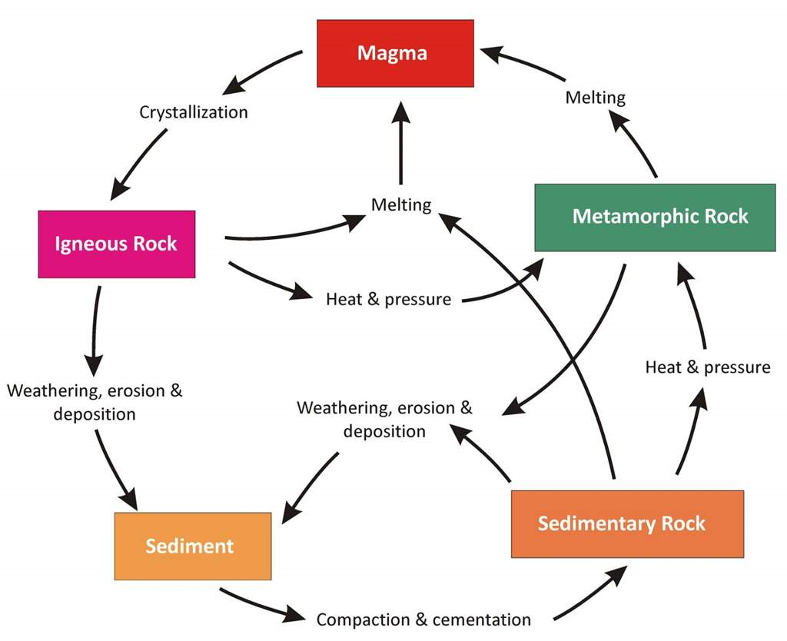
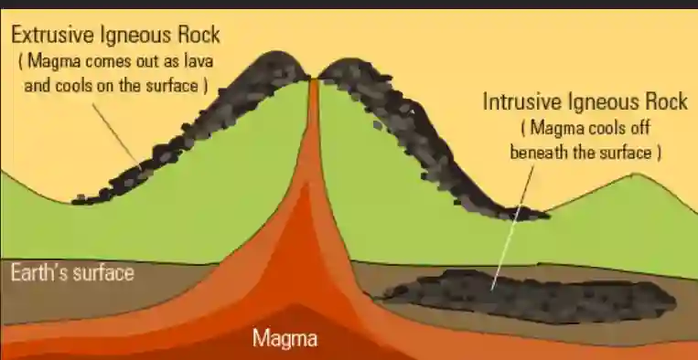
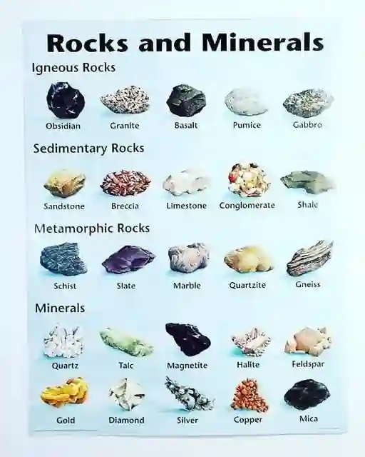
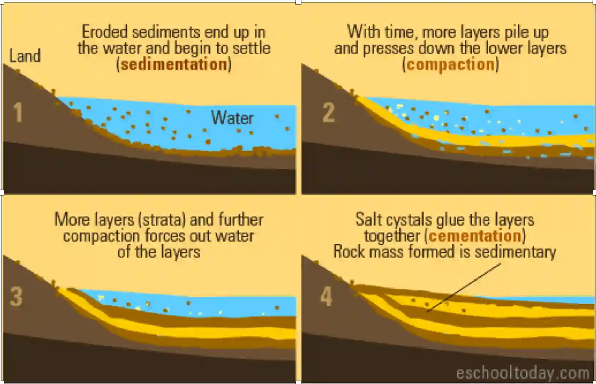

# Rocks and Minerals and their Exploitation

## Formation of Rocks

* **The Rock Cycle** represents the changes between the three rock types and the processes causing them.

  Rock cycle showing the five materials (such as igneous rocks and sediment) and the processes by which one changes into another (such as weathering):

### Types of Rocks

* **Igneous rocks:**
  * Made when liquid magma cools to form solid rock.

  * When volcanic activity occurs, the magma/lava (molten rock) is released from the mantle and reaches the surface.. As this magma cools and solidifies, it forms igneous rocks.

  * Igneous rocks can be characterized by their crystalline structure.

  * They are harder to break than sedimentary rocks and less susceptible to erosion

  * They can be classified into two types based on depending where they cool off:

    1\. Intrusive/Plutonic -  If the magma/lava cools slowly and beneath the surface. They are large and visible. eg. granite, diorite, gabbro.

    

    2\. Extrusive/Volcanic - If the magma/lava cools rapidly on the surface. They are usually small.
    eg. basalt, obsidian, rhyolite

* **Sedimentary rocks:**
  * Formed by the weathering of existing rocks at the Earth’s surface.

  * Fossils may be present.

  * Sediments (small particles of rocks) accumulate into layers and get pressurized due to the newer deposits above them.

    

  * The sediments are transported by water and wind (erosion).

  * Particles like clays, silts, sands, gravels, and small boulders are found in sediments.
* **Examples:** limestone, sandstone, flint and shale.
* **Metamorphic rocks:**
  * Rocks that undergo transformation (heat, pressure and/or chemical reactions) within the Earth's crust.
  * The changes alter the mineral composition, texture, overall shape without melting it.
  * They are called metamorphic rocks because of the process of metamorphosis (change) that preexisting rocks undergo.
  * Preexisting rocks (Igneous, Sedimentary and even some Metamorphic rocks) metamorphose and give rise to a newer rock.
  * The changes can be physical, chemical, or both.
  * **Examples:** marble, slate, schist, gneiss, quartzite, anthracite.