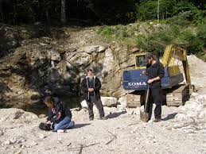
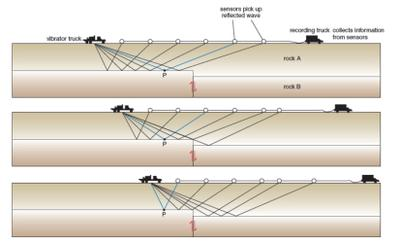
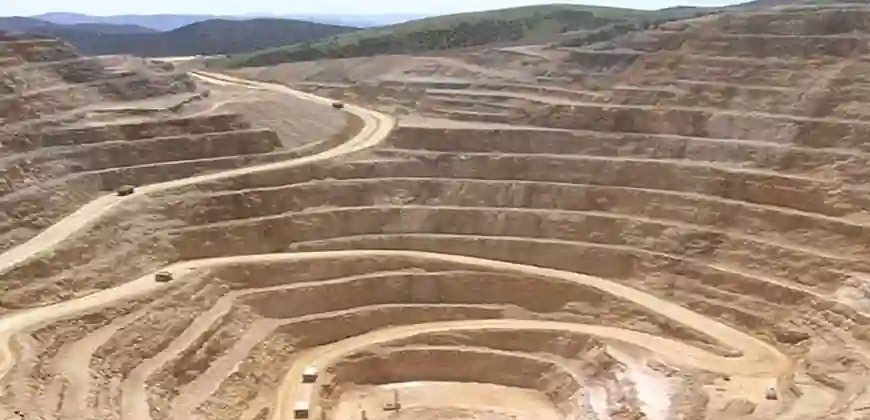
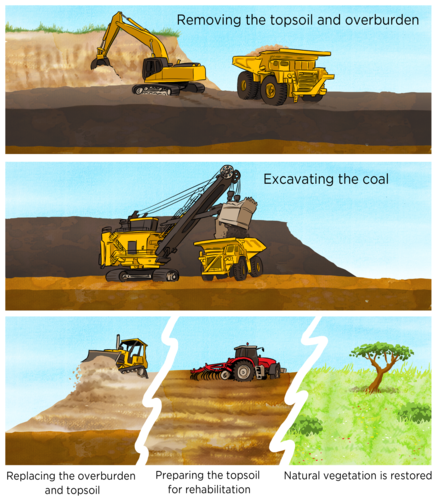
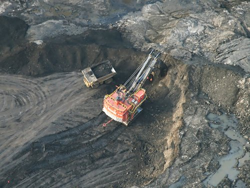
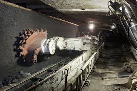
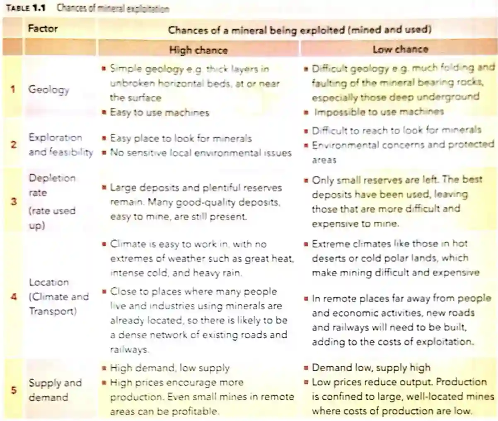

## Extraction of Rocks and Minerals from the Earth

Minerals are the building blocks of rocks, but rocks are not made of minerals. Mining often involves extracting rocks to get to the valuable minerals within them. For example, iron ore is a rock containing iron minerals, and we extract the iron from the ore.

### **Extraction of Minerals**

* **Prospecting:** a process of searching for minerals by examining
  the surface of the rocks
* **Ore**: A rock with enough important minerals to make it worth mining

### **Methods of Exploration**

* **Remote Sensing:** a process in which information is gathered about the Earth’s surface from above.
  * Photographs of the area are taken from the air.
  * The images are carefully analyzed for mineral presence.
  * Aerial photography can cover more ground than a person on the
    surface.
* **Satellite Signals:**
  * Some satellites send signals to the Earth’s surface and
    collect the reflected signals, indicating the presence of
    minerals.
  * The unique radiation pattern is processed and analyzed by computers
  * The system works in all weather conditions.
  * The GPS gives the exact location.
  * Large area covered in low-cost
  * Most efficient method

**Geochemical Analysis and Field Surveys**

* **Geochemical analysis**: analyzing the chemical properties of rocks (by taking samples).

* The samples can be taken from stream sediments, soil or rocks
  (using shallow drilling).

* The location of the sample points can be accurately found
  using the Global Positioning System (GPS).

  

* **Geophysics:** method to identify mineral ores in rocks using their physical properties.

  * A series of vibrations (seismic waves) are sent through the Earth’s surface.

  * Several sensors are placed at different distances from the
    source of vibrations on the surface.

  * The vibrations create shock waves that travel down into the rock layers.

  * They are reflected to the sensors on the surface.

  * The shock waves record different patterns depending on the minerals present in the rock layers.

    

### **Methods of Extraction**

There are two methods of extraction

* Surface mining
* Sub-surface mining

### **Surface Mining**

* Surface mining is the broad term encompassing the removal of vegetation/terrain surface to gain access to minerals. It is carried out when a valuable deposit is located near to the surface. It is most widely employed method in mining projects.

* Process of Surface Mining:

* The vegetation is cleared, and the topsoil is removed.

* The rocks/mineral layers are broken up and loosened with
  explosives.
* Loosened rock is then removed using diggers.
* The rock or mineral is tipped into trucks or railway wagons for transporting.
* There are many types of Surface mining. The key difference lies in how the mined-out areas are handled:
  * Open-cast - It involves backfilling with waste as mining is done.
  * Open-pit - excavation is much deeper and mining done on a larger scale.. It leaves large open pits after mineral deposit has been depleted/taken/exhausted.
  * Strip mining - removal of of soil and rock layers in 'strips' to expose mineral deposits. It is mainly used to mine coal and lignite
  * Quarrying - specific extraction of stone, sand and gravel and other construction materials. Quarries are a type of open-pit surface mine but not all surface mines are quarries.

### **Deep and Shaft Mining**

* Deep and Shaft mining also known as Sub-surface mining is when mineral deposits cannot be reached by using Surface mining. It is also referred to as underground mining.
* Process of Deep and Shaft mining:
* A vertical shaft is sunk into the rock layer containing minerals.
* A horizontal gallery/tunnel is then made to gain access to the ore body/mineral layer. Sometimes a horizontal adit is rather made to enter the mine.                            
* The minerals are extracted by digging (by machines and miners).
* Loose rock is bought out of the mine and collected as waste heaps.
* The minerals are brought to the surface and transported in trucks or trains
* **Resources:** Gold, Lead, and Silver.
* Advantages of Deep and Shaft Mining:
  - Produces fewer wastage
  - Disturbs less land
- Disadvantages of Deep and Shaft Mining:
  - Ground deformation and water pollution/flooding are potential risks.
  - More expensive form of mining
  - Dangerous to work in. Exit routes may be blocked upon collapse/when disaster occurs
  - Can still harm the environment

### **Factors that affect the decision to extract rocks and minerals:**

A mineral resource must be viable. It means that a mineral/rock/resource must be worthy for a company to invest in mining. It should be large and have sufficient value for it to be deemed economically viable.

#### **Geology:**

* High-grade ores yield more of the required chemical elements
  than low-grade ores.
* Small deposits of high-grade ore are worth mining.
* Small deposits of low-grade ore that cannot be mined at a profit are left as reserves.
* Surrounding rock must be stable
* Depth of the deposit-surface mining is cheaper and safer
                                    - deep underground mining requires shaft which is expensive and dangerous
* Overburden- layer of soil and rocks above the minerals. If the overburden is hard and large, it is more expensive and difficult to extract the mineral

#### **Climate:**

- Temperature extremes affect equipment, can be a risk to worker safety and operational schedules
- Nature of extraction in arid climates vs cold regions can have their own limitations. Mining processes require large water quantities which may be hard to obtain in torrid zones. In polar regions frozen ground complicates excavation and transportation.
- Natural disaster can cause damage to infrastructure, halt operations and increase costs.

#### **Accessibility:**

* Transporting the ore from the mine to processing plants can be
  difficult and expensive.
* The cost of building road or rail links to the processing plant or the nearest export port must be considered.
* Carrying out some processing at the mine reduces transport
  costs.
* The mining company must be given a license before extracting a deposit.
* A long-term agreement between the government and mining companies must be reached to avoid rapid rises in the tax, which makes mining unprofitable.

#### **Environmental Impact Assessment:**

* Certain countries might have stricter environmental laws that could impact project feasibility.
* For the license application to be approved, the company must have a plan to keep the loss of habitat minimal, followed by the restoration of land and the completion of mining.
* The choice of site for mine waste should also be considered.

#### **Supply and demand:**

* The relation between how much of a commodity is available and how much is needed or wanted by the consumers.

* Demand for minerals fluctuates. It rises in times of industrial growth and falls during an economic recession.

* An increase in world demand for any mineral ore will elevate the prices.

* High prices encourage more production.

* The profit from a working mine depends on changes in supply and demand.

* If the demand is too high, mines that were not profitable before becomes worth mining, even small mines in remote areas can be profitable.

* If the demand falls, working mines may lose due to the transport and extraction expenses. Also, low demand could rationally lower the price of the output. This also reduces the production of the output. Production is then confined to only large, well-located mines where costs of production are low.

* High demand low supply (or) demand low and supply high

  