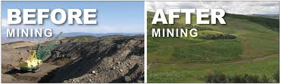
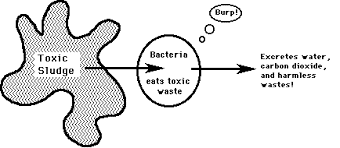

## Managing the Impact of Rock and Mineral Extraction

### **Safe Disposal of Mining Waste**

* Mine waste must be stored to prevent collapse.
* The mine site must prevent the chances of water pollution.
* The waste must be monitored to detect any movement or further
  pollution.

### **Land Restoration**

**Landscaping/Restoration:**

* Bulldozers can be used to level and smooth out the surface. Land is made to look like a natural landscape so that it looks like it hasn't been disturbed by mining. Treed, grasses can be planted.

**Soil improvement:**

* After (sanitary) landfilling, mine waste can be covered by a layer of soil that can be enriched with fertilizer. This process is called as Reclamation. The land is reclaimed from mining to be used for farming. Farmers are able to start using the land again.    

**Landfilling:** the waste is tipped into a hole; from time to time, it is levelled off and compacted.

**Sanitary landfilling:** As in landfilling, the waste is used to fill the hole, but alternating layers of waste and sand are used.

**Tree planting:**

* Trees bind soil together. Shelter ground surface from heavy rains. Act as shelter belts from winds.
* After improving soil fertility, plants and trees can be grown in that area, helping an ecosystem to be reborn.

**Bioremediation:**

* It is a process of removing pollutants from waste using living organisms.

* **In situ treatment:** treatment of contaminated waste where it’s left.

* **Ex-situ treatment:** removal of contaminated waste from a site to a treatment plant.

* Often happens slowly (can be sped up by providing oxygen and nitrogen).    

* Microorganisms, like bacteria, can absorb pollutants and metabolize them into less harmful substances.

* Some plants can bioaccumulate toxic metals.

* After these plants grow for a while, the parts of the plants aboveground are removed so the waste in the ground becomes less toxic.

### **Making Lakes and Natural Reserves**

* Several tree and herb species are introduced. This will help maintain the biodiversity
* As their populations grow, they create habitats for many species.
* These nature reserves become valuable green spaces for human recreation and help maintain biodiversity.
* If the rock lining the hole (created by the extraction) is non-toxic and impervious to water, it can be filled with water to form a reservoir or lake.
  * It is used to irrigate farmland or process and provide clean, safe drinking water for humans.