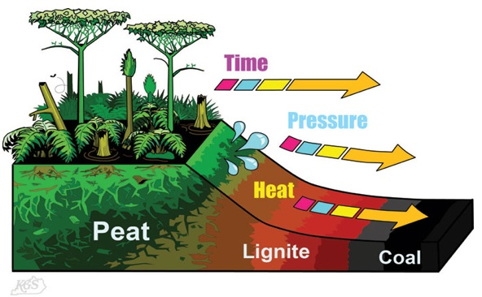
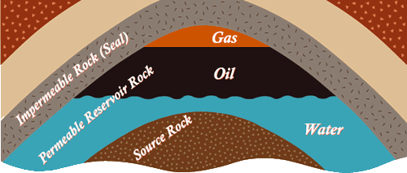

# Energy and the Environment

## Fossil Fuel Formation

* **Fossil fuels:** carbon-based fuels formed millions of years ago from the decay of living matter. They are finite sources.
* **Coal:** from decomposition of plants and animals over a period of millions of years.
* **Oil and natural gas:** formed from sea creatures. Natural gas and oil are trapped under the impervious rock layer and at the top of the sandstone rock layer
* **Formation of coal:**
  * Huge forests grew millions of years ago, covering most of the Earth.      
  * The vegetation died and formed peat.
  * The peat was compressed between layers of sediments to form lignite (low-grade coal).
  * Further compression formed coal.

**Formation of oil and natural gas:**

* Small animals and plants die and fall to the bottom of the sea.
* Sediments cover their remains.
* As the sediments start forming layers, they start to change into
  sandstone as the temperature and pressure increase.      
* The heat and pressure turn the remains into crude oil and natural gas.
* They separate and rise through the sandstone, filling in the pores.
* The rock above the oil and gas is **impervious** (non-porous).
* So, they get trapped underneath it. 
* Then the oil and gas is extracted by a drilling rig  Oil companies can dril down through the impermeable rocks to get it out. They are then able to turn it into products of use i.e., petrol, diesel etc