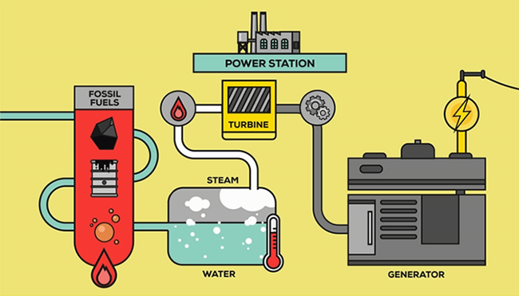
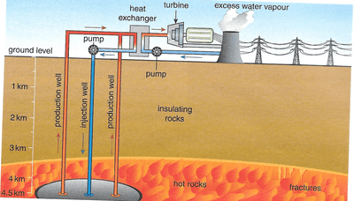
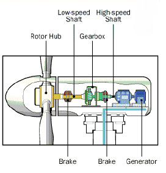
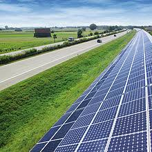
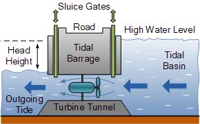
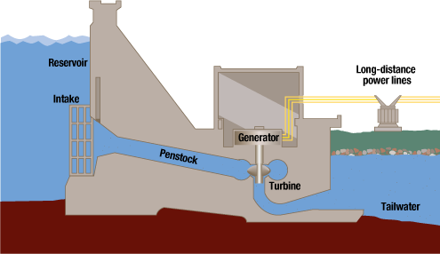

## Energy Resources and the Generation of Electricity

**The demand for energy is increasing worldwide due to:**

* Increasing population size.
* Increasing industrialization and urbanization.
* Improvements in standards of living and expectations.

**Types of Energy Sources:**

|Non-renewable|Renewable|
|:---|:---|
|Oil|Geothermal power|
|Coal|Hydro-electric power|
|Natural gas|Tidal power|
|Nuclear power (using uranium)|Wave power|
||Wind power|
||Solar power|
||Biofuels e.g. bioethanol, biogas and wood|

* Nuclear fuels last for centuries and are a good replacement for
  fossil fuels, but the source material (uranium) is limited.
* Biofuels may become limited, but it can be renewed by replacing the
  cut-down trees with new ones to obtain bioethanol and wood.
  * Biogas can be obtained by recycling waste products.

### **How energy sources are used to generate electricity:**

* **Electromagnetic induction**: a process used for generating
  electricity that uses the movement of a metal coil and a
  magnet. Transforms Kinetic energy to electrical energy through a turbine connected to a generator.
* **Turbine**: a machine, often containing fins, that is made to
  revolve by gas, steam or air (it is connected to a generator).
* **Generator**: a machine that converts mechanical energy into
  electrical energy.

**Fossil fuels and Biofuels:**        

* These produce a massive amount of energy during combustion
  that is used to heat water and convert it into steam, which
  thereby drives the turbines.

**Nuclear power:**

* Nuclear fuels release energy through nuclear reactions, rather than through chemical reactions.
* Uranium, a radioactive element, releases huge amounts of
  energy when nuclear fission (splitting of the atom) occurs.
* This energy is used to heat the water, produce steam. Then expanding steam spins turbines, which then drive generators to produce electricity.

**Geothermal power:**

* Cold water is pumped under pressure into a layer of hot rocks.
* The rocks heat the water.
* The hot water returns to the surface under pressure and heats
  the second supply of water using a heat exchanger.
* The steam produced in the second supply moves the turbine,
  generating electricity.

**Wind power:**

* Wind turbines have shafts (blades) that rotate due to wind.
* Gearbox maximises the rotation of the shaft.
* Brakes slow down or stop the rotor in very windy conditions,
  preventing damage to the blade.
* As the turbine rotates, the generator produces electricity.

**Solar power:**

* Uses photovoltaic cells that produce a small electric charge
  when exposed to light.
* A bank of cells organised into solar panels produce a
  significant amount of electricity.

**Tidal power:**

* Uses the natural rise and fall in the level of water in an
  area.
* When the levels drop, water is held back by a tidal barrage (a
  small dam that releases water back through a turbine).

**Wave power:**

* Also uses turbine and generator.
* Uses the smaller differences in water levels that are caused
  by wind.

  

**Hydro-electric power:**

* Uses a dam on a river to store water in a reservoir.
* Water is released from the reservoir that flows through the
  turbine, rotating it.
* The turbine then activates a generator that generates
  electricity.

### Using Different Energy Resources

**Economic Factors**

* Countries use their own fuel supply, as it is cheaper than importing. Depending on their local fuel supply, e.g. Middle East and its Oil, while others take advantage of natural occurring sources e.g. Iceland and geothermal energy.

* The usage of alternative renewable energy depends on the cost of investing in these technologies

**Social Factors**

* Depending on local areas and the industries they support, the impact of energy sources may differ.

* Areas for mining or oil drilling, make it unsuitable for agriculture, but it with emerging industries more, more jobs are created.

* The development of new technologies might affect existing workers in sectors that start to decline.

* Development of new technology may affect the political relationships and trading patterns between two nations, e.g. less dependency on oil supplying trade partner.

**Environmental Factors**

* **Pollution** from oil spills or burning of fuels, harms wildlife and the atmosphere.

* **Changes to the ecosystems** through installation of renewable sources or extraction procedures, can destroy/alter habitats and life structures for ecosystems.

* **Visual impact** of changes to natural landscapes

---

|Fuel Type|Advantages|Disadvantages|
|:---|:---|:---|
|Fossil fuels (oil, coal, natural gas)|Provides job opportunities (mining and processing); The technology used is well-known and the methods of extraction are well-practised.|Carbon dioxide and toxic gases are released when burnt contributes to global warming; Damages local area; Limited supply (non-renewable). Causes prices to rise if supply decreases|
|Nuclear power (using uranium)|Does not produce carbon dioxide (impact on climate change); Small amount of fuel produces large amounts of energy; Power plants employ lots of people|Risk of radiation leakage (impact on human health and environment); Waste products cannot be recycled as radiation active for centuries; Limited supply|
|Biofuels (bioethanol, biogas, wood)|A renewable source: bioethanol and wood are both obtained from growing plants, biogas from the recycling of waste products; Growing more plants uses carbon dioxide; Potentially a plentiful supply|Carbon dioxide and other toxic gases produced when burnt; A lot of land is needed to grow crops for fuel; Potential removal of natural ecosystems to grow fuel crops|
|Geothermal power|Does not produce carbon dioxide; Unlimited supply as uses the heat from the Earth as the power source|Can be expensive to install; Only certain areas have suitable conditions|
|Hydroelectric power|Does not produce carbon dioxide; Water can be reused for other purposes|Building of dams impacts the natural flow of water; Villages and ecosystems may be destroyed when dams and reservoirs are built|
|Tidal power|Does not produce carbon dioxide; Tidal movements not dependent on weather conditions|Limited to specific coastal areas; Impacts on the tourist industry and local fishers|
|Wave power|Does not produce carbon dioxide; A renewable source of power|Limited to specific areas; Currently not very efficient, so large amounts of resources needed|
|Solar power|Does not produce carbon dioxide; Sunlight is not a limited resource|Only efficient under certain weather conditions; Generation only occurs in daylight hours; Visual impact and potential damage to local ecosystems|
|Wind power|Does not produce carbon dioxide; Uses a renewable resource|Not all locations are suitable; Generation only occurs in certain conditions (at certain wind speeds); Visual impact; Uses a large area|
