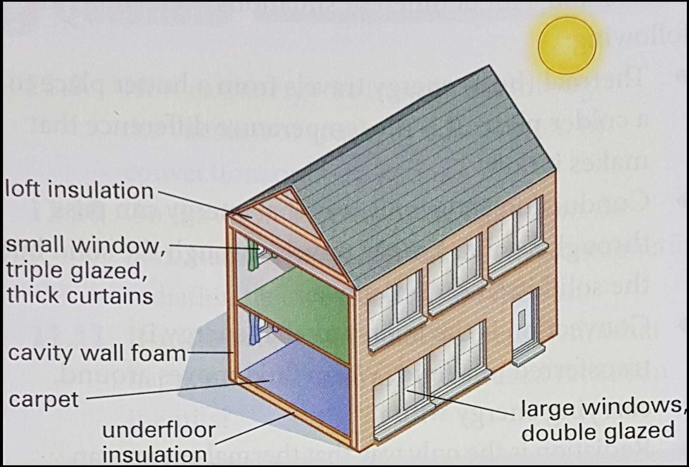
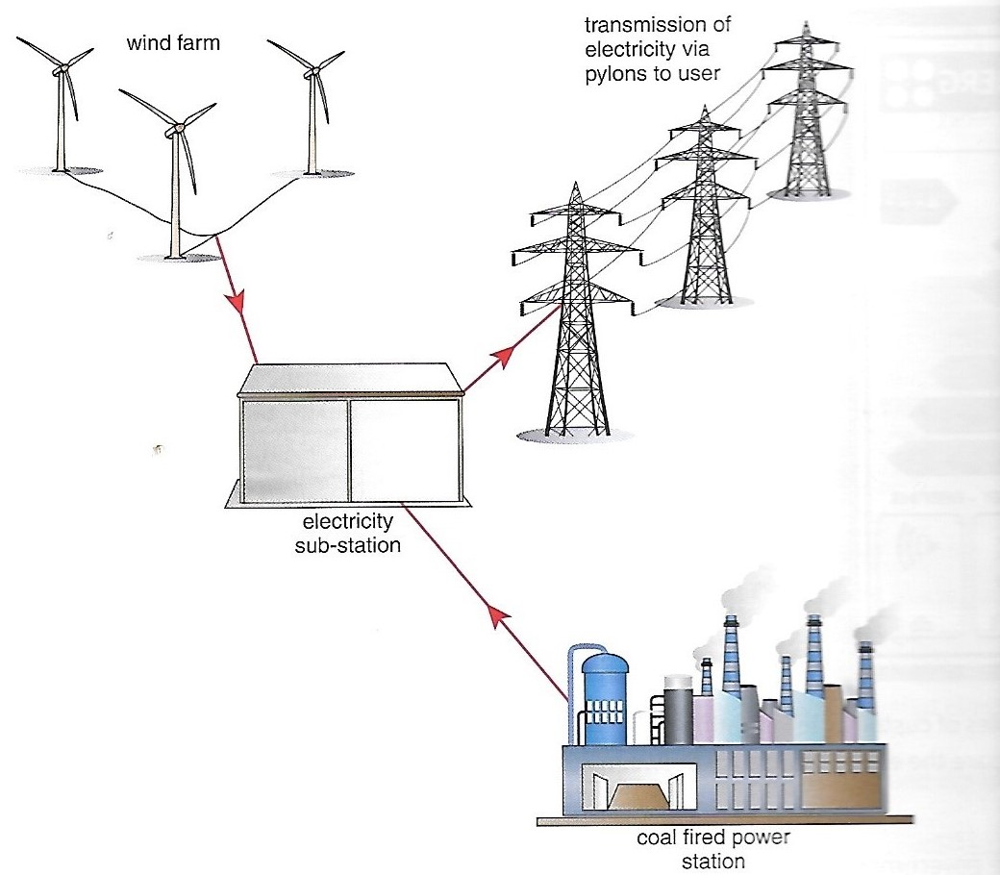
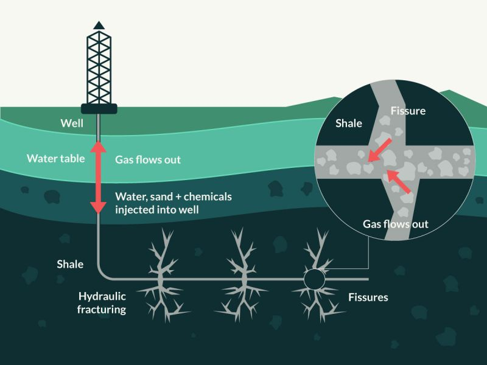

## Conservation and Management of Energy Sources

### Strategies for the efficient management of energy resources:

**Reducing consumption:**

* Reducing the amount of energy used to heat a building.

* **Insulation:** constructing using material with good
  insulation properties prevents loss of heat.
* **Loft insulation:** adding an insulation layer into the roof
  space.
* **Underfloor insulation:** adding an insulation layer on the
  floor e.g. carpet.
* **Cavity wall insulation:** a gap between inside and outside
  walls is filled with an insulating material, causing the heat
  to pass through more slowly.
* **Double glazing:** two panes of glass with a gap in the
  middle to act as an insulator.
* This sealed gap is usually filled with air or an inert gas
  e.g. argon.
* Triple glazing can also be used, but it is too expensive.
* Electrical devices must be turned off when not in use.
* Devices can be left in ‘standby’ mode and can be accessed
  rapidly.
* More energy-efficient devices must be bought.
* Developing alternative fuels for vehicles and further
  development in engine technology.
* **‘Scrappage’ schemes:** remove inefficient machines from use
  (electrical appliances or vehicles).

**Energy from waste:**

* Reusing existing materials to extract energy from them before
  they are disposed.
* **Anaerobic digestion:** breaking down of organic matter
  (waste food and vegetation) using bacteria.
* This process takes place in a sealed container and releases
  methane (a flammable gas) that can be used for heating
  purposes.
* The composted waste can be used as organic matter to improve
  soil structure.
* Household rubbish can be incinerated (burnt) to produce heat,
  that can be used to generate electricity;

|Advantages|Disadvantages|
|:---|:---|
|Waste from burning (ash) is small in volume. Thus, it doesn’t take up much space.|Produces poisonous gases during combustion.|

* Vegetable oils, once used, should be disposed;
* These oils can be collected and recycled into biofuels suitable
  for running vehicles;
* It can be used exclusively or as an additive.

**Education:**

* Benefits of the technology must be communicated to others;
* Promote new ways of thinking;
* The message must be that significant savings in energy bills
  can be made over the longer term, reducing energy use;
* Energy-efficiency ratings must be provided for new products to
  compare with the old ones.
* **Laws passed by the government to make changes rapidly:**
* **Stricter building regulations:** new constructions must be
  more energy efficient.
* Preventing the sales of inefficient types of electrical
  devices.
* **Incentives to encourage the purchase of more efficient
  technologies:**
* Insulating older houses that are energy efficient;
* Replacing older, inefficient electrical devices;
* Scrapping older, inefficient cars, that emit more pollutants.

**Exploiting existing energy resources:**

* The type of energy source used depends on social,
  environmental and economic factors.
* The current solution is to use a renewable resource as a
  primary energy source when possible and have a fossil-fuel (or
  biofuel) powered station available as a backup when weather
  conditions are not suitable.

* This is a reliable source for industry and households and
  reduces the amount of fossil fuels used.

**Transport policies:**

* Regulations regarding the quality of exhaust gases from
  vehicles;
* Check on the fuel efficiency;
* Restrictions on where vehicles may go;
* Taxation on fuels;
* Surcharges for travelling to certain places at peak times;
* Improving public transport so it is easier and cheaper than
  using cars;
* Improving routes for cyclists and pedestrians;
* Encouraging car-sharing;
* Restricting when cars can be used e.g. odd even rule in Delhi;
* Providing incentives to buy more fuel-efficient vehicles and
  for vehicles using cleaner technology.

**Development of new resources:**

* **Fracking:** Fracking is the hydraulic fracturing of gas and oil rich shale rocks. They are fractured by injecting high pressure chemicals and fluid into wells. The shale rock fractures releases the hydrocarbon from that location back to the surface
* A vertical hole (2-3 km deep) is drilled to reach the fuel-rich
  rocks (shale rocks).   
* A specialized perforating gun is lowered through the hole and fired, to create small inch long fractures.
* Water, sand and chemicals are pumped down into the shale rock layer.
* This causes the rock to fracture, releasing oil and natural gas,
  which are forced back to the surface and collected.
* **Purpose of the three components:**
  * **Water:** easy to handle (in high pressure).
  * **Chemicals:** stop the blockage of pipes.
  * **Sand:** keeps the cracks in the rock open.

|Advantages|Disadvantages|
|:---|:---|
|Access to more oil and gas|Risk of toxins entering the water table|
|Less pollution than burning coal|Chemicals are toxic and may affect local residents|
|Reduces the need for imports|Uses a lot of water; may cause water scarcity|
|Provide many jobs locally|Noise pollution, Natural areas damaged and may cause additional earth tremors|
