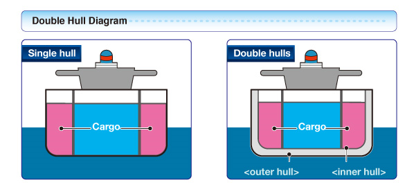
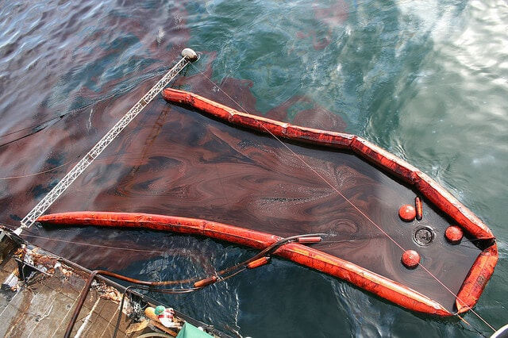

## Management of Oil Pollution

**Reducing oil spills in marine environments:**

* **MARPOL (Marine Pollution):** International Convention for the
  Prevention of Pollution from Ships. 
* **Regulations of the MARPOL:**
  * Supervise the transport of oil at sea;
  * All tankers must be certificated to show they have appropriate
    systems in use;
  * Else, it can result in a heavy fine or the ship may not be
    permitted to leave port.
* **Tanker design:**
  * Oil spill can be caused by damage to the hull (a hole in the
    hull of the boat causes its contents to leak).
  * **Increase in the number of compartments within the hull of
    the ship:** if one of the compartment’s damaged, the contents
    of the whole ship aren’t lost.
  * **Double-hulled tankers:** if the outer layer’s damaged, the
    contents are still secure by the inner plate.
  * Though double-hulled tankers cost more than single-hulled, the
    risks of oil spill are far less.

**Minimising the impact of oil spills:**

* **Floating booms:** a floating barrier is used to surround the
  oil slick, preventing it from spreading.
* This process works well when the spill covers a relatively
  small area and the sea is calm but is less effective in high waves.
* **Detergent sprays**: detergents help break down the oil slick into smaller droplets, that eventually degrade, and disperse it.
* They are effective on smaller spills, but cause damage to the
  coral reefs themselves as they’re not tolerant to detergents.
* **Skimmers:** clean the water using a material that oil easily
  attaches to.

* The skimmer drags oil off the seawater surface, that is then
  scrapped off into a container.
* This system is used when oil slick is contained within a boom
  and the sea is calm.
* When the oil reaches beaches, it can only be removed by hand
  (difficult and time-consuming).
* **Sorbents:** materials like peat moss, which are used to absorb oil.
* **Controlled burning:** a method of burning freshly spilled oil, usually while it is floating on the water surrounded by booms.
* **High-pressure hoses:**  for washing oil off beaches.
* **Vacuum trucks:** to remove spilled oil from beaches or the water’s surface.
* **Chemical dispersants and biological agents:**  these break down oil into very small droplets, which can then biodegradable.