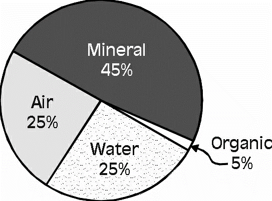

# Agriculture and the Environment

## Soil Composition

Soil is the outer, loose layer that is found just below the surface of the Earth.
It is important because it is the medium in which most plants grow. It is a mixture of four things:

* **Mineral** **particles**: combination of rock fragments and other inorganic substances.
* They are formed due to physical, chemical and biological weathering of the parent rock.
* **Organic content**: mixture of living plants, animals, microorganisms and their decaying remains called humus.
* **Air**: held within the pore spaces (between the mineral particles and organic content). Air is rich in CO2.

  Air enters the soil by diffusion.     
* **Water**: held within the pore spaces (water that is available for
  plant growth).
* Water enters the soil when there’s precipitation or when the soil is
  irrigated.
* **The proportion of these components depends on:**
* Type of soil;
* Way it has been managed;
* Local climatic conditions;
* Size of the mineral particles.

**Soil can be classified into three groups:**

|Type|Size|Texture|
|:---|:---|:---|
|Sand|2.0-0.02 mm|Gritty|
|Silt|0.02-0.002 mm|Silky or soapy|
|clay|\<0.002 mm|Sticky when wet and Hard when dried|

## Soil weathering

Weathering is the breakdown of large rocks (bedrock) into tiny mineral particles over thousands of years. It occurs in 3 ways:

* Physical Weathering**:** Freezing and thawing water cracks rocks apart, or wind blows sand against rocks to wear them down

* Chemical Weathering: Rainwater (which is slightly acidic) reacts with minerals in the rock, dissolving them or causing them to crumble

* Biological Weathering: Plant roots grow into small cracks in a rock and split it open as they expand.

## Decomposition

* Decomposition is the process where microorganisms like bacteria and fungi and detritivores like earthworms break down dead organic matter such as fallen leaves, dead plants, and animal remains.

* It transforms raw dead waste into humus

* Humus acts like a sponge, helping the soil retain water and slowly releasing critical nutrients back into the dirt for plants to absorb.