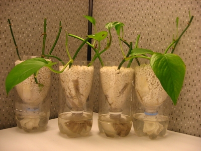
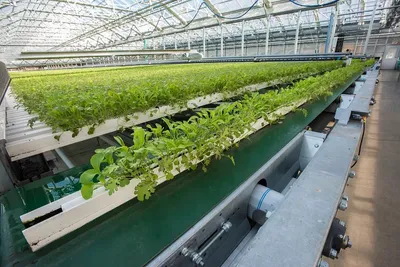

## Increasing Agricultural Yields

* Increase in the populations of people, increases the pressure on food production by:
  * The need for more resources for growing populations

  * Climate change effecting fertile land availability

  * Decrease in available farming land due to the increase in settlement building.

  * Availability of water reduced for irrigation because of growing population.

### **Techniques for improving crop yield**

**Crop rotation**:

* It is a method of farming where a number of different plant are grown one after the other on the same field so that the soil stays healthy and fertile.

* Growing the same kind of plants in the same plot, may cause:

  * Build up in diseases, effects future plant growth

  * Increase in pest

  * Depletion of soil nutrients, as the plants use up the same ratio of nutrients each year.

* **Advantages of crop rotation:**

  * Diseases in the soil affecting the plant are left behind;
  * Pests need to find a new site, their population is reduced;
  * The soil in the new plot is likely to have the essential nutrients;
  * Crops ready to harvest at different times, less potential waste, less labour and machinery needed.
  * Its helps to control the build-up of bacteria, fungus or parasites that might cause plant disease or insect pest that might feed upon them. In turn this saves the farmer money because they will need to use fewer chemical pesticides.
  * If deep- rooted crops are alternated with shallow- rooted crops in the rotation then this will help to improve soil structure.

* Examples of simple crop rotation:

  * **Legumes**: plants in the pea and bean family, that contain nitrogen-fixing bacteria in their roots to produce a source of nitrates.

  * **Leafy** **crops**: vegetables that are required for their leaves, requires a lot of nitrogen fertilizer (left in the soil by legume roots). Planted after legumes,

  * **Root** **crops**: have deep root systems. Helps break up soil, because of soil cultivation. Legumes can be planted afterwards, as it needs well cultivated soils.

  * **Fallow**: the land is ploughed but left barren for a period to restore soil fertility and to avoid surplus production.

**Fertiliser**:

* Contain minerals such as nitrogen, potassium and phosphorus (NPK). All essential for plant growth.

* Farming interrupts the natural nutrient cycle. When crops are harvested, the nutrients they contain are removed from the soil . This, along with heavy plowing, depletes the soil's content of vital minerals as NPK. Over time, this process reduces the humus content of the soil, making it unable to support adequate crop growth. Therefore, fertilisers are added to replace these lost nutrients and maintain soil fertility.

* When used incorrectly, causes environmental damage, as they get washed into rivers and lakes by rainfall.

Ranges of fertilisers are classified into 2 groups:

* **Organic:**

  * Derived from natural sources

  * Examples: animal manure, composted plant materials, bone meal (ground-up animal bones), hoof and horn (these parts of the animal ground up) or dried blood.

  * Manure and compost are quite bulky, but they make **good soil improvers**, **increasing water-holding capacity** of sandy soils and **increasing air spaces** in compacted, clay soils.

* **Inorganic**

  * Manufactured in a factory

  * Typically more uniformed from batch to batch, **formulated** to provide precise amounts of each nutrient.

  * **Cleaner and less unpleasant** to handle than compost and manure, less bulky so **storage and transport easier**.

  * less bulk and denser, so cheaper to transport

* **Quick acting fertilisers**: fast acting, deficiency problems are dealt with swiftly, but can easily leach out in heavy rain.

* **Slow acting fertilisers**: Long lasting, no need to reapply, but Little immediate impact if plants may already have a deficiency problem

* Farmers use different fertilisers for different needs of plants, and the soil conditions.

**Irrigation**:

* the method of supplying water to the crops.

* Large percentage of a plant is made up of water, it is essential for cell activity and photosynthesis.

* Mineral nutrient uptake requires water in the soil, hence the water must be free from pollution and low in salt, or else it may damage crop plants.

Common water application methods:

* **Overhead Sprinklers**

|Advantages|Disadvantages|
|:---|:---|
|Easy to set up|Large droplets may cap the soil|
|Can cover a large area from one sprinkler|Small droplets may be blown away by wind|
|No need to attach pipes to each plant|Water lands on leaves and soil, which evaporates quickly|

* **Clay Pot Irrigation System**

|Advantages|Disadvantages|
|:---|:---|
|Simple technology;|Only suitable for permanent plants;|
|Easy to check the amount of water;|Large labour cost.|
|High efficiency.||

* **Trickle Drip System**

|Advantages|Disadvantages|
|:---|:---|
|Water placed directly at the base of the plant;|Expensive to install; complex to maintain.|
|Automated and controlled via computer;|Grit can block tubes;|
|Water is used very efficiently.|Inflexible; cannot be moved easily.|

* **Flood Irrigation**

|Advantages|Disadvantages|
|:---|:---|
|Inexpensive;|Inefficient use of water;|
|Can cover large areas quickly.|Damages soil structure.|

**Control of competing organisms**

* Growth of a crop can also be reduced by attacks from other organisms that can feed on it, weaken it and in extreme cases kill it.
* **Weed**: a plant growing in an inappropriate place
* **They must be controlled because they:**
  * Compete with crops for light, water and nutrients;
  * Reduce the quality of a seed or grain crop;
  * Might be poisonous;
  * Make cultivation difficult;
  * Can block drainage systems with excessive growth;
  * Can be a source of pests and diseases;
  * Can look untidy (impact on tourism areas).
* **Weed control**: weed-killing chemicals are known as **herbicides**.
* **Advantages of herbicides**:
  * Easier to manage
  * Alternatives may be less effective
  * Cheaper
  * Results are more predictable
  * Less labour needed
  * Effect is more rapid
* **Alternatives to herbicides are cultural controls:**
  * **Cultural controls**: hand weeding and hoeing are useful methods for removing individual weeds but require a lot of labour.
  * **Weed barriers**: using black plastic sheeting over the ground or a deep layer of composted organic matter (mulches) helps smother weeds. Mulches **prevents growth of weeds**, but also prevents evaporation of water from soil, leads to **waterlogged soils**.
  * **Flame guns**: paraffin (kerosene) is a highly flammable liquid that can be used in a flame gun to **scorch off the tops of weeds and kill weed seeds** at the soil surface, but it has **risks**.

**Controlling pests and diseases**

* **Pest**: an animal that attacks or feeds upon a crop plant.
* **Pesticide**: used to control pests.
* **Insect** **control**: insect-controlling chemicals are called **insecticides**.
* **Crop** **disease** is caused by fungi, bacteria or viruses (pathogens)**.** The most common are fungal diseases and are controlled by **fungicides**
* **Biological Control:** alternative to insect control, through finding natural predators, that feed on pests and thus control the infestation.

|ADVANTAGES|DISADVANTAGES|
|:---|:---|
|No chemical residues|Not as instant as chemical control|
|No impact of sprays|Pests may breed faster than the predator|
|No need of reapplication|Predator may feed on an unintended plant|
|The predators will die naturally when the pests are controlled||

**Mechanisation:**

* Larger area can be cultivated using advanced technology
* Reduces labour cost
* Ploughing can be done even when soil is heavy
* Additional attachments can be done to apply fertilisers and
  pesticides
* Tractors can carry heavy loads, useful at harvest times.
* Large fields are needed for large machinery, which changes the landscape by the removal of natural vegetation to smooth the operation. 
* Moreover the machinery compresses soil or damages soil structure and encourages loss of wildlife habitats through clearance of vegetation for easy use of machinery.

**Selective breeding:**

* The traditional method used for improving the performance of crops and
  livestock.
* The process of selective breeding:
  * Choose parents that exhibit the desired characteristics of the
    species

  * Raise the offspring from these parents

  * Select the best offspring that shows the desired characteristics

  * Repeat the process.
* **Examples:** beef cattle, dairy cattle, wheat and rice.
* **Drawbacks:** slow process; less success rate.

**Genetically Modified Organisms (GMO):**

* **Gene**: a sequence of DNA that is responsible for a characteristic of a living organism.

* **Genetically modified organism (GMO)**: an organism whose genetic material has been altered by genetic engineering.

* Different reasons for genetically modifying plant species:

  * Disease and pest-resistance: genes can be cut from a resistant plant and added to a crop plan.

  * Nutritional value: plants can be developed that are more nourishing.

  * Crops can be grown in inhospitable areas

  * Herbicide resistance

  * Crops with longer storage lives, less food wastage.

* Concerns about the development of GMOs:

  * Unknown impact of the new characteristics on human health

  * Products are not natural

  * Genes might get into wild plants if they interbreed with GMOs, reducing biodiversity

  * Reduction in the gene pool

  * issues for other insects caused by insect-resistant varieties

**Controlling the crop environments:**

* **Greenhouse:** a building made of glass or similar transparent material that is used to manage the environment for plant growth.

* Helps control environments for specific plants, that may need special growth factors to be able to grow.

|Growth factor|How to increase|How to Decrease|
|:---|:---|:---|
|temperature|Operate heating system (e.g. insulation).|Open roof ventilators.|
|Light|Supplementary lighting.|Shading material in the roof.|
|Humidity|Misting units.|Open roof ventilators.|
|Day length|Supplementary lighting.|Shading material and curtains.|
|Water|Sprinkler or irrigation.|Drainage material underneath.|

* Investment in additional equipment for a greenhouse system is expensive and require a lot of additional labour, only cost-effective for an expensive crop.

* Most modern greenhouses employee sensors to monitor the environmental conditions, when linked with a computer it is able to operate the equipment automatically.

* **Hydroponics:** growing plants without soil, with the nutrients the plant needs, dissolved in water; this technique is often used in conjunction with a growing blueprint.

* **Growing blueprint:** the growing requirements of a crop throughout its life, which a grower can use to maximise the yield.

* The most common method is to float plants on polystyrene rafts on a reservoir of moving water.

* Sensors measure the amount of key minerals nutrients, and add more as needed.

* Air is bubbled through to ensure roots have enough oxygen to respire.

|Advantages of hydroponics|Disadvantages of hydroponics|
|:---|:---|
|No need for soil.|Expensive to set up|
|Portable, can be set up anywhere.|Restricted to small prodcution scales|
|Intensive system that can provide high yield|Techincal knowledge requirments|
|Easy to harvest|disease, if present, spreads rapidly through the water|
|Exact nutrients are given to plants in the irrigation water|Conditions need to be maintained at optimum levels, or else plants die quickly|
|No weeds or pests and diseases in the 'soil'||
|Pollutants are not released into the environment||
