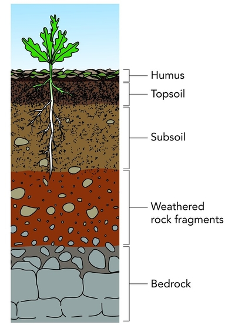

## Causes and Impacts of Soil Erosion

* The topsoil’s structure, holds water and supports airspace, makes it a perfect layer for root growth. The loss of this layer, can affect the fertility of the soils

### **Causes of soil erosion:**

* **Removal of natural vegetation**: no more roots to bind the soil
  together or slow down the torrents of water, so flash flooding and
  rainwater run-off pick the soil and carry it away.
* **Overcultivation:** Ploughing breaks the soil into smaller and
  lighter particles. These are more easily carried away by wind.
* **Overgrazing:** Livestock reduces the vegetation to nearly ground
  level, sometimes leaving no roots to hold the soil.
  * Animals trample down the plants and their hoofs compact the ground.
* **Wind erosion:** Deforestation (due to the need for space, excessive
  grazing, increase in the development of arable crops) increases the
  chance of soil getting eroded by wind.
* **Water erosion:**
  * **Heavy rain fall**, dislodges soil particles, loosening them to be eroded in other ways.
  * **Rainwater run-off**, excess water that cant be absorbed by soil, carries it away to another area.
  * **Gully erosion**: gullies and streams contain a volume of water moving at speed that erodes the local soil even further, forming deeper and deeper crevices.

### **Impacts of soil erosion:**

* **Topsoil is removed:** the most productive layer is absent (subsoil
  lacks nutrients and air spaces).
* **Organisms living in the topsoil lose their habitat:** impact on
  the entire ecosystem.
* **Silting up of watercourses:** Flooding occurs as water bodies
  can’t hold excess water (space taken up by silt).
* **Silt deposits can form lagoons:** providing breeding grounds for
  mosquitoes.
  * Silt affects the quality and availability of water for drinking.
* **Aquatic organisms are buried under the silty layer**: preventing
  light from reaching the underwater plants (low oxygen levels in
  the ecosystem no photosynthesis).
* **Desertification:** the process by which fertile land becomes
  desert.
  * Severe droughts lead to migration of the whole community.
  * Risk of famine and malnutrition, due to fewer food sources.