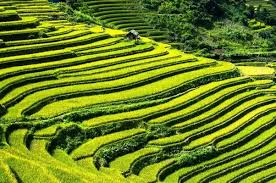
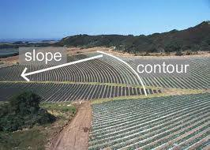
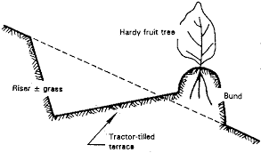
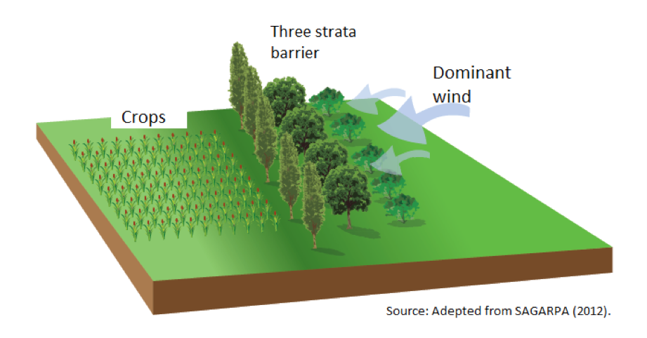
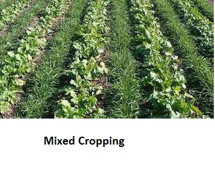

## Managing Soil Erosion

### **Terracing**

* **Terracing:** the artificial development of flat areas (for growing crops) in a sloping terrain.

  

* **In a natural slope**, water runs down, increasing in speed and volume, carrying soil in the run-off.
* **In a terraced slope**, water is held in the flat terraced areas, causing less risk of run-off and more chance of infiltration.
* Very labour-intensive, the long term effect, reduces the water erosion of soil, instead of running off, it will infiltrate (soak into) the soil.
* Crops like rice benefit from standing water, the pools of water and used to grow plants in.

### **Contour ploughing**

* **Contour ploughing:** a technique where the furrows caused by ploughing follow the contours of the land.

  

* Ridges and troughs (furrows) run along the contour. Each furrow holds water and prevents large torrents of water from running down the slope, preventing the formation of run-off soil.
* Useful for when seeds start to emerge, to protect the root system from erosion, until it is able to bind well with the soil.

### **Bunds**

* **Bund**: an embankment constructed around the edge of an area to reduce the loss of a liquid (such as water).

  

* Useful for crops that require moist soils, e.g. rice.
* The water is retained on the terrace.
* Increases the quantity and fertility of the soil.

### **Windbreaks**

* **Windbreaks**: a permeable barrier, made of either living vegetation or artificial material, used to reduce the impact of the wind on an area.  

* Windbreaks helps prevent wind erosion.

* **Solid structures**, like walls, force the wind into smaller spaces, increasing wind speed and causing eddy currents.

* **Permeable structures**, like vegetation, allow wind to pass through, decreasing its speed and, thus, the amount of wind erosion.

* **Advantages**: additional habitats for beneficial insects; roots of the windbreak prevent erosion (run-off).

### **Maintaining vegetation cover:**

* Cultivated soil is most prone to erosion, as there is no vegetation to hold it together. To reduce the risk, farmers usually maintain a vegetative cover on the land for as long as possible
* In some cases it may mean planting an additional cover crop, for example sowing legumes immediately after a crop has been harvested, prevents soil erosion.
* It also provides more nitrogen to the soil, increasing its fertility for the next major crop. When cultivating, the legumes can be ploughed.
* Other methods include the **“no dig” method**, where existing vegetation is left until the moment a new crop is ready to be sown, but rather than cultivate the soil the farmer applies a herbicide to kill off existing weeds. 
  * This method is not without risk, as residue of the herbicide can build up and affect crop.

### **Addition of organic matter to improve soil structure:**

* Soil can be replenished by adding of more compost/manure, to reduce the risk of it being uncovered, especially if it has been **broken into small particles** and is **lightweight**.
* Effects of additional organic matter:
  * It provides additional air gaps in heavy soil

  * Increases the number of soil organisms in the soil (because they are feeding on the organic matter)

  * Adds nutrients to the soil, increasing the fertility 

  * Regarding soil erosion, improves the general soil structure.
* It acts like a sponge, holding the extra water and preventing soil dehydration and erosion of soil particles.
* Reduces soil erosion as the organic matter acts like a base for smaller particles.

### A multi-layered approach to cropping

**Tree planting:**

* A row of trees acts as a windbreak;
* Tree canopy can provide shade for smaller plants that don’t thrive
  in direct sunlight;
* Provide a natural habitat for animals that feed on pests;
* Tree leaves fall to the ground and add to the organic matter.

**Mixed cropping**

* Growing more than one type of plant in the same area.    

* Resources in the soil, like nutrients, are used more efficiently.

* **Intercropping:** the technique of growing other crops between the rows of a main crop, maximising the use of nutrients and water

* **Crop rotation:** (refer to section 3.4 Increasing agricultural
  yields; Crop Rotation).