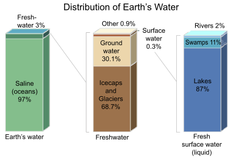

# Water and its Management

## Global Water Distribution

* Oceans cover **75%** of the Earth’s surface.
* Oceans and seas contain **97%** of all the Earth’s water.
* Only **3%** of the water on Earth is **fresh water**.
* Nearly **two-thirds (65%) of this 3%** **fresh water** is in the **‘deep freeze**’ in the ice sheets.