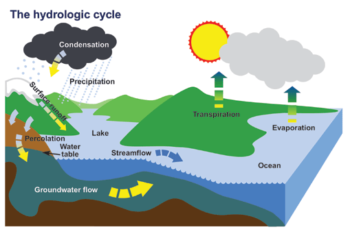
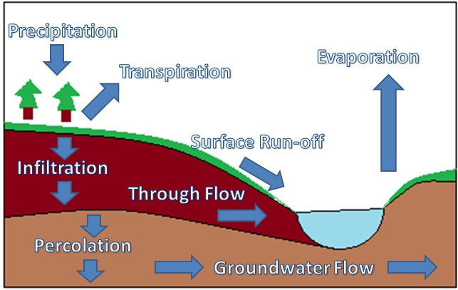

## The Water Cycle

- The state of water changes the location of it, if water in ice is solid, the melting of this ice turns it in to liquid, that may run into a stream of water. The movement of water can be:

  - **Surface run-off:** precipitation that flows over the ground
    surface, eventually finding its way into streams and rivers.

  - **Through-flow:** down slope movement of water through the soil,
    roughly parallel to the ground surface.

  - **Ground water flow:** slow horizontal movement of water through
    rock.

- Once water flow gets collected to form a body of water or joins another body of water (e.g. pond, lake), the warmth of the sun or the heat of the earth below (magma) causes the water to evaporate.

  - **Evaporation:** water from oceans, seas and other water bodies is changed from water droplets to water vapour (invisible gas) in the atmosphere due to heat.

  - Water vapour can also evaporate/diffuse from leaves of a plant, through **transpiration.**

- **Condensation:** water vapour converted back into liquid (water droplets) or solid (particles of ice) due to a decrease in temperature with increasing height by air currents, e.g. clouds.

- The clouds that were formed from the condensed vapours, start growing heavy from the water droplets/particles of ice, the water will fall from these clouds in form of rain or ice.

  - **Precipitation:** the process in which liquid water (as rain) or ice particles (as snow or hail) fall to Earth due to gravity.

  - **Interception:** precipitation that doesn’t reach the Earth’s
    surface due to being obstructed by trees and plants.

  - **Infiltration:** precipitation soaks into sub-surface soils and
    moves into rocks through cracks and pore spaces.
  - **Percolation:** Movement and filtration of fluids through porous materials

