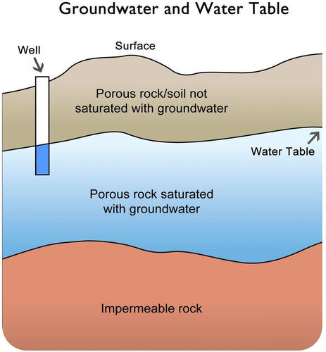
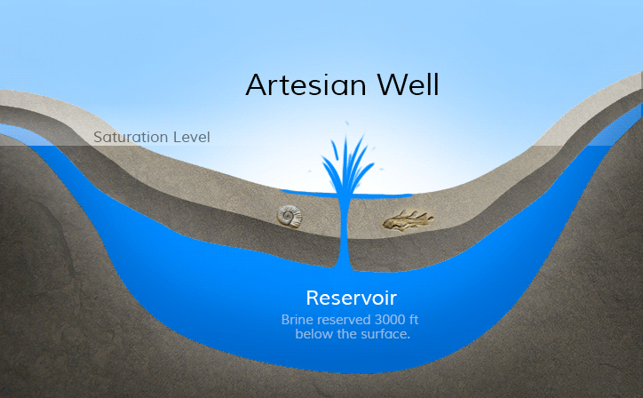
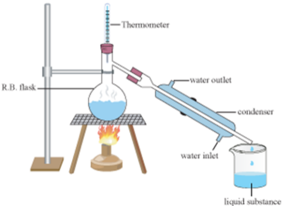
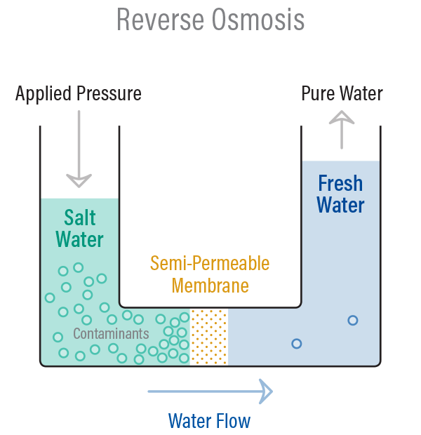

## Water Supply

* **Surface water:** water in lakes, rivers and swamps.
* **Ground water:** water in the soil, and in rocks under the surface
  of the ground.
* **Aquifers:** water stored in porous rocks under the ground.

* Alternating layers of permeable and impermeable rocks trap the water in permeable rock, creating folded layers of rock. Water accumulates the most in the down fold.
* Permeable rocks outcropping on the surface receive new supplies of
  rainwater
* Water that is stored in limestone and sandstone (porous) rocks below the water table, need mechanical pumps or human labour to raise water to the
  surface.

### Main sources of fresh water for human use

**Aquifers**

* The global quantity of water in aquifer, is about 30% of all fresh water supply.

* Most common ways to obtain water in aquifers is through wells.

  * **Wells:** a hole bored or dug into rock to reach the water stored
    in them.

  * Water does not raise to the surface, needs either hand lifting through buckets, or the use of pumps to bring water to the surface.

* **Artesian aquifer:** an aquifer in which the water is under pressure.

  * Water from a well sunk into an artesian aquifer will rise to
    the surface without the need for a pump.

**Rivers**

* **Rivers:** a large, natural stream of water flowing in a channel to
  the sea, a lake, or another river.
* They provide surface transfers of water to low-land areas where
  farms, villages, towns and cities are concentrated.

**Reservoirs**

* **Reservoirs:** an artificial lake used as a source of water supply,
  usually created behind a dam or by the side of a river (bank-side
  reservoir).
* The water is usually not potable (safe to drink), needs to be treated.
* **Service reservoir:** a reservoir where potable water is stored for use
  e.g. Water tower and Cistern.

**Desalination**

* **Desalination:** removal of salt from seawater. Over 97% of all the world's water is in the ocean and salty.

2 methods of desalination that can be used to make water potable:

* **Distillation:** water is boiled and released as vapour, leaving salt behind.
  * The vapour is then condensed as liquid water and can be used.

  * 10-30% efficient and uses a lot of energy. This and the addition of transporting the potable water, add to the cost.

  * The leftover salt (brine), would need to be disposed off, and the provision of the energy used for distillation are sources of pollution.

* **Reverse osmosis:** pumping of salt water at high pressure through a fine
  membrane.
  * 30-50% efficient and requires lesser energy than distillation.

  * Brine also needs disposing off, but the energy required for reverse osmosis is less the distillation.

  * Most desalination plants use the reverse osmosis method.

