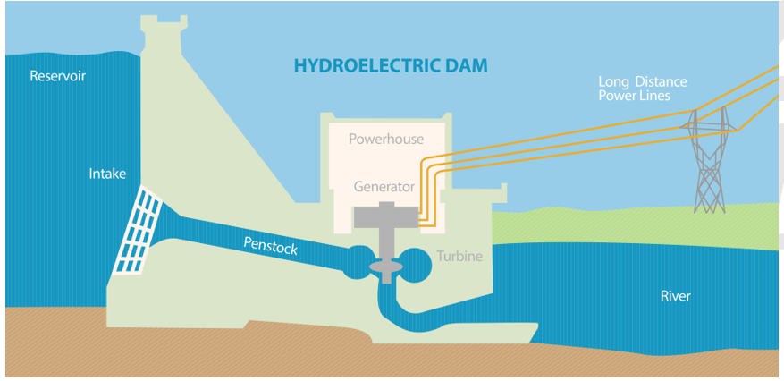

## Multipurpose Dam Projects

* Reasons for building dam include multi-purpose uses such as water supply for domestic and industry, irrigation water, increased food output, hydro-electric, tourism, navigation, and flood control.
* The construction of dam maybe expensive and controversial, which has its disadvantages but also advantages:

|Advantages|Disadvantages|
|:---|:---|
|Generation of electricity in hydro-electric power plants;|Relocating people;|
|Flood control;|Flooding land;|
|Irrigation|Disrupting the life cycles of fish and other aquatic organisms|
|Creates recreational land for tourism and leisure|Dam may become redundant due to sediment build up|
|Provision of water|Very expensive to build|
|Creation of habitat for wetland species|Requires maintenance|
|Access by boat to otherwise inaccessible areas|Reduces jobs for farmers if natural fisheries are affected|
|Renewable source of energy|Altering water supply for people downstream the dam|
|Doesn’t produce greenhouse gases|Reducing soil enrichment downstream of the dam|
|Reduces fossil fuel consumption||
|Creates more jobs||
|||

* **Example:** the Ramganga Dam, Uttarakhand, India and Aswan High Dam in Egypt

**Choice of site**

The optimum site choice needs to have:

* High precipitation to provide sufficient water
* Low temperature to prevent evaporation
* Built on strong impermeable rock, so water doesn’t drain and has a
  good foundation;
* Built high up in order to have good potential for hydroelectric power
* Narrow, steep sided valley for economic reasons
* Rivers and lakes nearby to provide water
* Away from developed areas to reduce the risk of pollution in reservoirs
* Easily accessible
* Maximises water storage capacity

**Sustainability of dams:**

* Alternative for burning of fossil fuels as no greenhouse gases are
  produced.

**The unsustainability of dams:**

* Reservoir can become silted due to material carried into it by rivers
* Dam structure under a lot of pressure can deteriorate and eventually fail
* Have negative effects on the environment and fish population