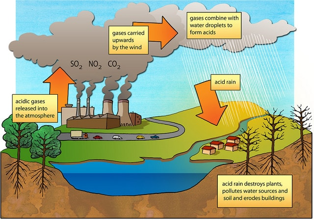
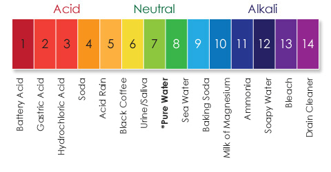

## Impact of Water Pollution

### **Global inequalities in sewage and water treatment:**

* Developing countries have difficulty treating water and sewage compared to developed countries as people aren’t educated and can’t put pressure on the government.

### **Risk of infectious bacterial diseases, typhoid and cholera:**

* Water-borne diseases are caused by drinking contaminated water.

|Bacterial diseases|Cholera|Typhoid|
|:---|:---|:---|
|Infective bacterium (pathogen)|Vibrio cholerae|Salmonella typhi or Salmonella paratyphi, which causes a less severe illness|
|Time before onset of symptoms after infection|A few hours up to 5 days|6–6 days|
|Symptoms|Diarrhoea and vomiting|Fever, abdominal pain with a skin rash, Diarrhoea and vomiting are not uncommon|
|Consequence|Can be mild but can lead to dehydration and death|3–3% of infected people remain as carriers with no symptoms, If untreated, fatal complications can arise|
|Treatment|Rehydration, a vaccine exists|Antibiotics, a vaccine exists|

### **Accumulation of toxic substances from industrial processes in lakes and rivers:**

* Reduces oxygen in lakes and rivers, less oxygen available for respiration increasing death of fish and insect larvae.

* **Biomagnification of toxic substances in food chains:** increases concentration of a toxic substance (e.g. mercury and pesticides) in the tissues of organisms at successively higher levels in a food chain, causing illness.

* **Bioaccumulation:** accumulation of a toxic chemical in the tissue of a particular organism.

### **Acid rain**

* **Formation of acid rain:** burning fossil fuels such as coal and oil produce sulfur dioxide ($SO_2$) and oxides of nitrogen ($NO_x$) that are blown long distances and react with water in the atmosphere.

* $SO_2$ dissolves in water to form sulfuric acid, and $NO_x$ dissolves to form nitric acid that fall in the form of rain.
* **pH:** measured by acidity or alkalinity.
  * Ranges from very acidic, 1, to very alkaline, 14.
  * 7 is neutral.

**The effect of acid rain on organisms in rivers and lakes:**

* Lower pH makes the environment intolerable for aquatic life
* Fish egg-laying is reduced, and young fish are malformed
* Leaching of heavy metals such as aluminum, lead and mercury from the
  soil into the water
* **Leaching**: the movement of a soluble chemical or mineral
  away from soil, usually caused by the action of rainwater.
* Aluminum clogs fish gills and causes suffocation
* Minerals essential for life, notably calcium and potassium, are
  washed out of the lake or river, reducing algae growth and leaving
  less food for fish and other animals

**Nutrient enrichment leading to eutrophication:**

* Increase in nutrients, such as nitrates and phosphates, in a water
  body causes algae bloom (rapid growth of algae).
* Death of algae causes an increase in organic matter that acts as
  food for bacteria as they decompose the dead algae.
* Bacteria use up oxygen, reducing oxygen content in the water and
  causing the death of organisms.