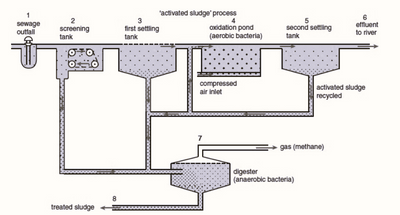

## Managing Pollution of Fresh Water

**Improve sanitation:** separates human excreta from contact with
humans, achieved by toilets and latrines. **Waste can be removed by:**

* Connection to a system of sewer pipes or sewerage, that collects
  human faeces, urine and waste water.
* Connection to a septic system, which consists of an underground,
  sealed settling tank.
* **Flush toilet:** uses a holding tank for flushing water, and a
  water seal that prevents smells.
* **Pour toilet:** has a water seal but uses water poured by hand for
  flushing.
* **Pit latrine:** type of toilet that collects human faeces in a hole
  in the ground that is sometimes ventilated to take away smells.
* **Composting toilet:** dry toilet in which vegetable waste, straw,
  grass, sawdust, and ash are added to the human waste to produce
  compost.

### **Treatment of Sewage**

* **Treatment of sewage:** aims to reduce the Biological Oxygen Demand
  (BOD) of the sewage.

1. **Sewage outfall:** waste water from homes and industries is taken
   to a sewage treatment plant in sewers.

2. **Screening tank:** large objects are removed from the waste using a
   coarse grid.

3. **Primary treatment, first settling tank:** solid organic matter,
   mainly human waste, settles at the bottom of the tank (sludge),
   which is treated in a sludge-digester.

   * Clean water then overflows the sides of the tank and is taken
     to the next stage.

4. **Secondary treatment, oxidation:** water is pumped into a tank
   where oxygen is bubbled through it.

   * This encourages the growth of bacteria and other microbes that
     break down organic matter, which cause BOD.

5. **Secondary treatment, second settling tank:** water enters, where
   bacteria settle to the bottom, forming more sludge.

   * This cleaner water overflows the sides of the tank as
     effluent, usually discharged into a river.

6. **Sludge digester:** oxygen-free conditions are created that
   encourage the growth of bacteria which can break down the sludge,
   releasing methane, that can be burnt.

   * Treated sludge can be dried in sludge lagoons and used as
     organic fertiliser on farmland.

7. **Tertiary treatment:** further filtering out of its effluent or its
   chlorination which produces even cleaner effluent that protects the
   habitat in which it is released.

**Water treatment:** Water is made potable by undergoing coagulation
treatment, being filtered and disinfected.

1. Raw water (non-potable), is carried through the system. Mixing and coagulation causes particles to clump together. **Coagulation:** Particles in the water are stuck together and settle to the bottom of the container.

2. Sedimentation causes clumped particles to settle out.

3. Filtration through sand, removes particles

4. disinfection with chlorine (chlorination), kills bacteria. **Chlorination:** to kill remaining pathogens, chlorine is added as a disinfectant.

5. Water is then taken to a storage/reservoir, and then out to distribution

**Pollution control and legislation**

* **Pollution control and legislation:** puts pressure on polluters to
  find ways to reduce pollutants.
* Industries are required to monitor the pollution they cause and keep
  it within set level.
* **Bi-national Great lakes water quality agreement (GLWQA):** a loading limit of phosphorus was set at 11000 metric tonnes $\text{year}^{-1}$ (per year) in response to eutrophication issues in the Great Lakes of USA and Canada.
* Fines for exceeding set limits.
* Companies may be prosecuted and in extreme cases, forced to shut
  down.
* Companies may need government agreement on strategic plans to reduce
  pollution levels.
* Incentives may be used to encourage companies to take part, such as
  grants or tax relief, for those that do achieve a reduction in
  pollution.