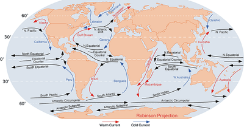
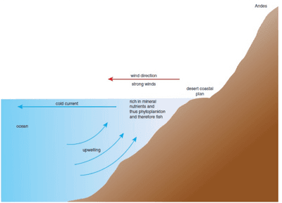

## World Fisheries

* **Surface currents:** movement of the surface water of the sea in a constant direction.
* **Prevailing wind:** the direction from which the wind nearly always blows in a particular area.
* **Currents**
  * Currents in the Southern Hemisphere are usually anti-clockwise.
  * Cold currents are near the north and south poles, for example Canaries current.
  * Warm currents are near the equator and the tropics, for example the Gulf Stream.

### **Distribution of major fish populations:**

* They are found in shallow continental shelves due to the large abundance of oxygen and phytoplankton.
* Physical difference between the continental shelf and the rest of the ocean floor include it being flatter, smoother, and gentler slopes, and shallower water.
* **Phytoplankton:** small organisms in the sea that can make their own food and upon which almost all other sea creatures depend for their food.
* They’re part of the food web, starting with the phytoplankton. Thus, fish are found where there are plentiful phytoplankton.
* Phytoplankton produce their food by photosynthesis which requires light, water, and carbon dioxide (CO$_2$).
* Water is abundant in the oceans, and CO$_2$ dissolves in the water from the atmosphere. Therefore, light is likely to be the limiting factor for photosynthesis.
* **Limiting factor:** One is in the shortest supply of all the factors that might affect a process.
* Water absorbs all light by depth of 200m. This zone is called **Euphotic zone,** the top 200 m or so of seawater through which light can penetrate and in which photosynthesis can happen.
* Major fish populations can be found in shallow waters around the continental shelf where sunglight can penetrate to the sea floor.
* They can also be found in coastal waters, around coral reefs, where ocean currents cause upwelling, and around oceanic islands.

**Not all areas with continental shelves have significant fisheries beca**

**use:**

* Phytoplankton need light, CO$_2$, and water, which allow it to make carbohydrates such as sugars but also require mineral nutrients to make proteins.
* Lack of these minerals, even with sunlight, water and CO$_2$, reduces the production of plankton.
* The most important fisheries of the world are where the current system stirs up
  decaying material from the seabed, they are rich in mineral nutrients.

### **El Nino Southern Oscillation ENSO**

* The world’s largest, most important fishery is the Peruvian anchovy fishery off the west coast of South America.

* In this area, cold water is forced upwards, near Peru’s coast, leading to nutrient-rich surface water in this area. This is called upwelling.

  * **Upwelling:** where minerals on the ocean floor are brought up to the surface by currents.

  * This has an effect on plankton growth, supporting large fish populations.

* The fishery yields an excess of 12 million tonnes of fish, however has suffered an enormous collapse due to overfishing.

  * **Overfishing:** when the number of fish caught is greater than the rate at which the fish reproduce, leading to a fall in fish numbers in an area.

* **El Niño Southern Oscillation (ENSO):** the change in the prevailing winds that lead to a change in the pattern of currents in the oceans of the South Pacific.

  * The upwelling of cold, nutrient-rich water is disturbed due to
    the change of prevailing winds
  * Leading to the upwelling of warm, nutrient-poor water
  * No nutrients mean the phytoplankton does not grow well, so there is less food for the fish.
  * This affects the fishing industry (namely anchovy fishes) negatively
  * An El Niño year brings heavy rain to the west coast of Peru because warm water off the coast, so more evaporation, warm air (by ocean) is likely to rise; leading to condensation or cloud / rain
  * Heavy rain improves argiculture
  * * **Fisheries decline off Peru's coast**

      * Warm, deep water rises but carries fewer nutrients/minerals

      * Phytoplankton (algae) don't grow well and die

      * Less food for fish (e.g. anchovies)

      * Lower oxygen levels

      * Fish die or migrate

    * **Climate change in Peru**

      * El Niño brings heavy rainfall and flooding to normally dry desert areas

    * **El Niño factors & forecasting**

      * Measure wind speed/direction and air/ocean temperature

      * Improved forecasting gives earlier warnings