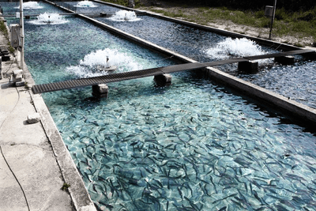

## Impact of Exploitation of the Oceans

**Causes of overfishing:**

* Demand for fish as food due to increasing world population, however technology and fishing methods that play a major part, as it has made fishing easier with bigger boats and detailed weather data.
* Economic gain, where fisheries catch all fish available, without thinking of the next
  generation of fishers and their customers.
* Creation of huge nets that scoop up everything in an area, often half of which is discarded as bycatch.
  * **Bycatch**: animals caught by fishers that are not the intended target of their fishing effort.

  * Shrimp fisheries are known to have the biggest bycatch of all, they account for only 2% of the world fishery catch but more than 30% of the world's bycatch.

**Impact of overfishing on marine fish species:**

* Change the size of fish, as well as their reproduction habits and maturing age.
* Harvest of untargeted/protected/endangered marine species that are discarded at the sea or shore (bycatch), leads to a loss of biodiversity.
* These changes disrupt the marine ecosystem, and create imbalances and erode food webs, which can endanger other marine life.

**Farming marine species :**

* Due to the increasing human population, the increased demand for fish as food is above the production capacity of oceans and seas.
* Overexploitation of the fisheries leads to a decline in wild fish populations, hence the idea of fish farming in **controlled environments.**
* **Aquaculture:** farming freshwater fish.
* **Mariculture:** aquaculture practiced in marine environments e.g. closed sections of an ocean, tanks, ponds, and raceways filled with seawater.
* **The new fishing methods are known as ‘industrial fish farming’**
  * Refers to large-scale, factory-like commercial operations

  * Includes ‘tuna ranches’ and other mass-production systems

  * Typically run by large companies using industrial methods
* **Advantages**
  * It reduces the pressure on the wild population, allowing their population to increase
  * Production is constant
  * No bycatch, as non-interest species are unlikely to be present on the farm
  * No erosion of seabed, which is usually caused by trawl nets.
* **Disadvantages**
  * More suspectible to disease and parasite than wild fish

  * Effects on the local environment; Chemical and antibiotics can leach into the surrounding soil and water. Can poison agriculture land.

  * Expensive to set up and maintain

    