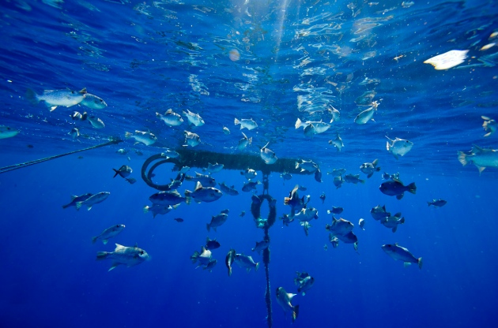

## Management of the Harvesting of Marine Species

* **Economic exclusion zone:** the zone around a country's coastline that is under the control of that country.

* It is required by the UN, that inside this zone the country must attempt to manage fisheries to make them more sustainable.

### Net types and mesh size and shape

* **Trawl nets**, including bottom trawl nets, catch all kinds of unwanted species and damage the seabed during their use.

* **Drift nets**, as their name suggests, drift with the current and are not anchored. These are often used in coastal waters

* Various kinds of **seine net**, including the purse seine, hang like a curtain in the water. A variant called the **surrounding net** is often used.

* **Dredge nets** are dragged along the seabed, mainly to catch shellfish and other types of fish living in the mud. For this reason they dig into the seabed with teeth or water jets.

* If the mesh size is too small, juvenile fish will be caught, which reduces the number of fish that grow to maturity and reproduce. Hence alot off nets with small mesh sizes are banned, e.g. drift net, trawl nets.

* A diamond-shaped mesh catches fish more easily. Thus, a square mesh panel is often included in an otherwise diamond net.

### **Other Methods of Fishing**

* **Fish Aggregation Device (FAD)**
  * These devices bait all the fish together and use a net to collect it
  * Leading to a large bycatch and more younger fishes

* **Pole and Line Fishing**

  * A selective and more sustainable method

  * Avoids unwanted bycatch since no nets are used

  **Fish Length Regulation**

  * Minimum catch size is 12 cm

  * Helps protect young fish and maintain breeding populations

### **Quotas**

* Legislators e.g., the government, set limits on how many and what type of fish can be caught;
  * The limits are set according to the information gathered from networks worldwide about fish populations.
  * These limits ensure enough fish can reproduce and replenish the fishery for the following season.
  * Each boat has a fish quota to get only a sustainable portion of fish taken

### **Closed Seasons:**

* Governments close down fisheries for a part of the year, usually during the breeding season.
* A limited number of fishing days each year. Helps prevent illegal fishing or enforcing quota system or prevent overfishing and for mating season
* **Protected areas and reserves:** some fisheries are protected by preventing fishing in certain areas, often where the target species is known to breed.
* ADDL Protects vulnerable ecosystems or limits the overall catch or protects fish stocks

### **Conservation laws and International Agreements (Implementing and Monitoring):**

* **Economic exclusion zone-**:the zone around a country’s coastline that is under the control of that country

* **International agreements**: needed to regulate fisheries in international waters, leading to the UN Convention on the Law of the Sea (UNCLOS).

* Countries can monitor varying levels of success

* **Conservation laws aim to:**

  * Conserve fisheries and the territorial waters
  * Conserve fishing resources
  * Protecting fish habitats
  * Enforcing international fishing agreements

* **Effectiveness of these strategies:**

  * Because of the vastness of the oceans, it is difficult to
    monitor fishery laws and agreements
  * Monitoring organizations based in ports have more success
  * Fishing is important for both income and food for many people, and there is a huge incentive for illegal activities
  * Quotas can easily be avoided by simply not declaring how many
    fish are being caught
  * Overstretched authorities may not be able to check every boat,
    and fishers may be willing to risk under-declaring the size of
    their catch and not being checked
  * Usage of the net with an illegally small mesh size, and in areas where patrols are inadequate
  * Fishers frequently trespass in areas where they are not
    supposed to fish