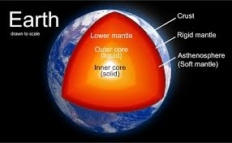
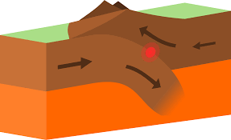
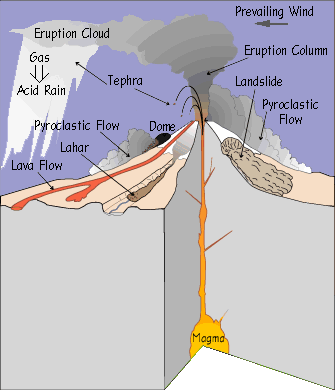

# Managing Natural Hazards

## Earthquakes and Volcanoes

**The structure of the Earth:**

Based on earthquake wave evidence, Austrian geologist Suess divided the Earth into three main layers: **Crust, Mantle, and Core**.

**Crust (Lithosphere, 8–33 km)**

* Outermost layer

* Two types: **Continental** (lighter, made of granite & aluminum) and **Oceanic** (denser, made of basalt & magnesium)

* Temperature: \~1200°C

**Mantle (Asthenosphere, \~2,900 km deep)**

* Upper mantle: highly viscous rock (source of magma)

* Lower mantle: solid rock

* Temperature: \~3,000°C

**Core (Barysphere, to \~6,400 km)**

* Very dense, with **convection currents**

* Composed mainly of **iron and nickel**

* Temperature: \~5,000°C

**Layers:**

|Layer|Temp (⁰C)|State|Material|
|:---|:---|:---|:---|
|INNER CORE|5000 – 6000|Solid (intense pressure from overlying rocks).|Iron and nickel.|
|OUTER CORE|4000 – 5000|Liquid.|Iron and nickel.|
|MANTLE|1000 – 1200|Liquid (flows slowly due to convectional currents from the core).|Mainly silicate minerals.|

**2 Types of Crust**

|Oceanic crust (sima)|Continental crust (sial)|
|:---|:---|
|Made out of basalt rock|Made out of granite rock|
|Thinner, with an average depth of 6m|Thicker, average depth 35, but over 100 under mountain ranges|
|Denser, 3 $gm^{-3}$|Lighter, 2.6 $gm^{-3}$|
|Younger|Older|
|Sinks, and constantly being renewed and destroyed|Cannot sink, neither renews nor destroyed|

* **The Theory of Plate tectonics**: a theory developed in the 1960s that helps explain the formation of some of the important features on the Earth's surface and how the continents move.
* The earth is not in a continuos layer, but is fractured and in sections called tectonic plates.
  * **Tectonic plate:** a piece of lithosphere that moves slowly. It is made of crust and upper mantle. The Earth is made up of 7 major and 8 minor plates.

  * **Lithosphere:** the outer and rigid layer of the Earth, comprising the crust and the upper part of the mantle
* The plates float like rafts on a mantle, heat from the core creates convention currents in the magma of the mantle, this causes the plates to move.
  * **Convection currents:** transfer heat from place to place, denser colder fluid sinks into warmer areas, heat from the Earth's core causes convection currents in the mantle.
* Plates can move away from, towards or sideways past each other.

### **Types of plate boundaries:**

* **Plate boundaries:** where two or more plates meet.

**Constructive (divergent) plate boundary:**

* When **two oceanic plates** move away, magma rises to the surface (convection current) and solidifies when it comes in contact with cold ocean water. Magma turns to lava and forms a new basaltic ocean crust. This process if called Sea-floor spreading/Ridge push.

  * **Sea-floor spreading:** the process by which oceans are formed at constructive plate boundaries, new oceanic crust is formed as two oceanic plates move apart.

  * **Ridge push:** a gravitational force that causes an oceanic plate to move away from the crest of a mid-ocean ridge and into a subduction zone, it works together with slab pull.

* They can build up and form mid-ocean ridges and submarine volcanos, which can grow and appear above sea level as volcanic islands.

* These volcanos are non-explosive (due to little pressure build up) and are called shield or basic volcanos

* If **two continental plates** move away from each other, a **Rift valley** may form.

**Destructive (converging) plate boundary:**

* A destructive plate boundary can be found between 2 continental and 2 oceanic plates.

* When **an oceanic plate and continental plate** move towards each other, the denser (oceanic) plate is forced down (subducted) under the lighter (continental) plate. **This process is called subduction/slab pull and takes place in the subduction zone.**

  * **Subduction/Slab pull:** the force at a destructive plate boundary, where the oceanic plate sinks beneath the adjacent plate, as a result of its own weight, the descending plate is pulled by gravity through the asthenosphere.

  * **Subduction zone**: a zone where the oceanic plate is deflected (subducted) down into the mantle, at the surface the subduction zone coincides with ocean trenches.

* An ocean trench is formed where the oceanic plate is subducted.

  * **Ocean trench:** a depression of the ocean floor that runs parallel to a destructive plate boundary. They are in the deepest part of the ocean.

* As the ocean plates push downwards, the pressure and friction causes huge earthquakes in the Benioff zone.

  * **Benioff zone**: a zone of earthquake foci in the upper part of a subducting oceanic plate at a destructive plate boundary.

* The heat cause by friction, causes the descending plates to turn into magma. The magma then proceeds to rise because of release of pressure and can erupt an explosive composite (strato) or acidic volcano.

  * **Composite volcano:** a volcano built up by alternating layers of lava and ash, conical in shape. Also known as a strato volcano.

  * **Acidic volcano:** a volcano that is made up of just lava, it is steeped sided as the lava does not flow easily, and it builds up into a convex cone-shape.

* The magma that erupts at the surface forms a chain of volcanic
  islands called an island arc.

* If **two oceanic plates** move toward each other, the older and denser plates subduct. The magma is then pushed upwards to form a chain of volcanic islands, called an **island arc**. The Japanese islands are an example of an island arc.

* If **two continental plates** move toward each other, the sediments between the two plates are compressed (collision zone) pushed upwards to form fold mountains, such as the Himalayas.

  * Earthquakes occur, but no volcanic activity (since no subduction of an ocean plate)

**Conservative plate boundary:**

* At a conservative boundary, no plates are being destroyed or created. Plates **slide past** each other.
* They move at different speeds, plates get locked together, and pressure builds up until it is released as an Earthquake.

### **Characteristics of earthquakes**

* When the ground shakes or moves in sudden jerks, it is a result from build up and sudden release of tension.
* **Focus:** the location under the Earth's surface where an earthquake originates.
* **Epicentre**: the point on the Earth's surface directly above the focus of an earthquake.
* The release of tension, sends out shock waves (seismic waves) that travel from the focus.
* The magnitude (strength) of an Earthquake is measured using a
  seismometer on the **Richter scale**.
* **Richter scale:** a measure of the magnitude of an earthquake, taken with a seismograph and with a scale of one to ten, ten being the most powerful, it is a logarithmic scale which means that if an earthquake measures two on the scale
  it is ten times more powerful than an earthquake that measures one.

|Richter Magnitude|Earthquake effects|
|:---|:---|
|<2|Not felt by people|
|2-3|Felt little by people|
|3-4|Ceiling lights swing|
|4-5|Walls crack|
|5-6|Furniture moves|
|6-7|Some buildings collapse|
|7-8|Many Building destroyed|
|8<|Total destruction of buildings, bridges and roads|

* The ground may suffer from **liquefaction** if it is made of loose sediments,
  and aftershocks can occur.
* **Liquefaction**: the process where loose sediments with a high water content behave like a liquid when shaken by an earthquake
* Earthquakes under the sea or in coastal areas can create **tsunamis**.

**Factors that affect the impact of an Earthquake:**

* Location of the epicentre, closer to the epicentre, the greater the damage.
* Time of the Earthquake, during winter or late at night, more loss of life.
* Geology of the area, determines liquefaction
* Relief of the area, e.g. mountains suffer from landslides, coastal areas can suffer from tsunamis
* Severity of aftershocks, can cause more damage as building may collapse
* Level of development of human settlement, effects coping ability
* Population density
* Building density and strength

### **Characteristics of volcanoes**

* **2 types of volcanic activity:**

  * **Intrusive**, magma cools underneath, forms igneous rocks.

  * **Extrusive**, magma flows out, in the form of lava.

* A volcano is a hole or crack (fissure) through which magma erupts onto the surface.

* Gases and pyroclastic material can also erupt.

  * **Pyroclastic material:** very hot gases, ash and volcanic bombs, pyroclastic flows can reach speeds of over 100 km h-1 at temperatures of 200 to 700 °C

* Most volcanoes are a mixture of magma and ash. They build up over time to form volcanic mountains or cones

* Two types of volcanoes:-

1. Composite - steep and cone shaped; made of layers of ash and lava eg. Mt. Etna (Italy)
2. Shield - sloping sides, runny lava; gases escape fast eg. Mauna Loa (Hawaii)

