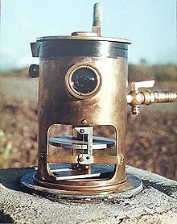
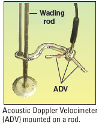

## Managing the Impacts of Natural Hazards

* Management Strategies focus on predictions, preventions or protections (before, during and after the event).

### **Tectonic:**

**Volcanoes**

**Prediction:**

* Seismometers can be used to monitor tremors caused by rising
  magma
* Satellites using heat-seeking cameras can be used to monitor
  increasing ground temperatures
* Tiltmeters (measure very subtle changes in the surface of the
  Earth as magma accumulates) and GPS can be used to monitor
  changes in volcano shape

* Emissions of steam and gas (sulfur dioxide) can be monitored

**Preparation and protection:**

* Volcano hazard map (study past eruptions)
* Lava diversion channels and lava barriers
* Spraying lava with water
* Halting lava advance by dropping concrete slabs into the flow
* Building reinforcements (sloping roofs to protect against ashfall)

**Earthquakes:**

* **Prediction:**
  * Monitor tremors (using seismometers), groundwater levels, and radon gas
  * Epicentres and frequencies of past events can be mapped to check if a pattern is developing
  * Measurement of local magnetic fields
  * A hazard zone map can be drawn (geological info and ground stability)
  * Unusual animal behaviour
* **Preparation and protection:**
  * Earthquake-proof or aseismic buildings. Older buildings can be
    modernised;
  * Smart meters to switch off gas supplies, preventing fires;
  * Land-use planning: important services (schools, hospitals)
    must be built in low-risk areas.
* Features of an earthquake proofed building:
  * Rubber shock absorbers at the base to absorb earth tremors

  * Foundations sunk deep into bedrock

  * Cross-bracing steel beams allowing the building to move as a rigid structure

  * Computer-controlled weights on the roof to reduce shaking

  * Fire-resistant building materials

  * Open areas where people can assemble if evacuated/Roads to provide quick emergency services

### **Tropical cyclones:**

* **Prediction:**
  * Tracked using satellites.
* **Preparation and protection:**
  * Cyclone shelters
  * Buildings on stilts, so not flooded by storm surges
  * Embankments along the coast
  * Preserve mangrove swamps to absorb the energy of storm surges

### **Flooding:**

* Managing flood risks also involves the drainage basin, not just the river channels.

* **Prediction:**

  * Monitoring the amount of rainfall and river discharge using an
    ADV
  * Using the features of the drainage basin and type of storm to
    determine the severity of the flood.

* **Preparation and protection:**

  * Complex engineering projects, e.g. levees, flood barriers and dams (can be expensive and impact environments)
  * Soft engineering projects, e.g. afforestation and storage basins
  * Straightening, widening and deepening the river channel, e.g. dredging and clearing vegetation
  * Land-use planning to use higher land for settlements, restrict development on floodplains or increase green space
  * Use of sandbags and pumps
  * Adapt houses, e.g. position power sockets 1.5 m above ground level to prevent electrocution.

### **Droughts:**

* **Prediction:**
  * Monitoring precipitation and temperature.
* **Preparation and protection:**
  * Increase water supplies by dams, reservoirs, wells, percolation ponds, aquifers, pumps, water transfer by pipeline, and desalination
  * Water conservation, using storage tanks, spray irrigation, drought-tolerant crops, recycling water and reducing deforestation
  * Agricultural improvements, such as shelterbelts to decrease wind and evaporation, bunds to increase infiltration and fencing to control overgrazing
  * The government stockpiling supplies of water, food and medicine.