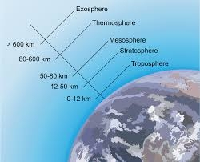
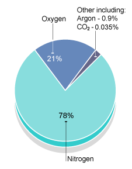
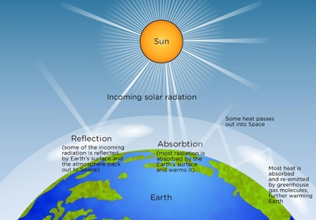

# The Atmosphere and Human Activities

## The Atmosphere

### **The structure of the atmosphere:**

* The atmospheric pressure decreases as the height increases in all layers of the atmosphere.

* The upper layers press down on the lower ones. So, the air of the lower layer is always heavier or denser, while the upper layers are thinner or less dense.

#### **The troposphere**

* The troposphere is the lowermost and densest layer

* Its height from the surface is 8 to 14.5 km

* 75% of the atmosphere and 99% of the water vapour and aerosols is found in this layer and its concentration decreases as we go higher from ground level.

* Temperature, gravitational pull and pressure decrease as altitude increase, whereas wind speed increases.

* **Tropopause**: the upper limit of the troposphere, temperature here remains constant

* This boundary occurs at a height of about 8 km at the poles and 17 km in the tropics, marks the upper limits of earth’s climate and weather.

#### **The stratosphere**

* Extends nearly 50 km off the earth’s surface, pressure continues to decrease, but temperature start increasing steadily with height.

  * **Temperature inversion:** when temperatures increase with altitude, cause by the concentration of ozone (as it absorbs ultraviolet radiation from the sun).

* A shield against incoming meteorites, they burn out as they enter earth’s gravitational field.

* **Stratopause:** the upper limit of the stratosphere, temperatures remain constant in this boundary layer

#### **The mesosphere**

* 50-80 km in height, pressure continues to fall and temperature drops rapidly to -80 °C, because there is no water vapour, dust or ozone to absorb the incoming short-wave radiation. Wind speeds reach up to 3000 km h-1.

* **Mesopause**: the upper limit of the mesosphere, temperatures remain constant in this boundary layer

#### **The thermosphere**

* 80-600 km in height, temperatures rise rapidly to as high as 1500 °C because of the
  absorption of ultraviolet radiation by atomic oxygen.

* **Thermopause:** the upper limit of the thermosphere, temperatures remain constant in this boundary layer

### **The Composition of the Atmosphere:**

|Component|% in atmosphere|Importance to Life on Earth|
|:---|:---|:---|
|Nitrogen (N~2~)|78.09|Growth of plants.|
|Oxygen (O~2~)|20.95|Produced by photosynthesis, used in respiration.|
|Water Vapour (H~2~O)|0.2-4|Source for Precipitation, Provides most of the natural greenhouse gases, Vital for existence of life|
|Carbon dioxide (CO~2~)|0.035|Used by plants in photosynthesis, greenhouse gas|
|Argon (Ar), Helium (He), Neon (Ne), Krypton (Kr)|0.93, traces|Can create an inert atmosphere that protects materials from reacting with oxygen or other gases.|

### **The natural greenhouse effect**

* The earth receives short wave radiation from the sun, half is absorbed by the earth’s surface, 20% is absorbed into the atmosphere and 30% are bounced back (by clouds and earth’s surface) into the atmosphere.

  * **Short-wave radiation:** incoming or short-wave solar radiation, visible light and ultraviolet radiation are commonly called shortwave radiation.

* As the earth warms, long wave radiation or infrared radiation is emitted back. The greenhouse gases absorb some of it and deflect back to the earth’s surface.

  * **Long-wave radiation:** outgoing or terrestrial radiation, as the Earth produces very little visible light or ultraviolet radiation, all radiation from the Earth is infrared.

* The greenhouse gases make up a small percentage of our atmosphere, but they act as a blanket, trapping earth’s radiation

|Name of the greenhouse gas|% contribution to the greenhouse effect|Number of years gas stays in the atmosphere|
|:---|:---|:---|
|Carbon dioxide|65|200|
|Methane|17|12|
|CFCs|12|50-1000|
|Nitrous oxides|6|114|
