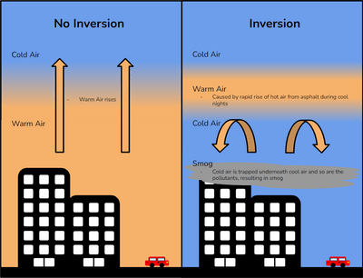
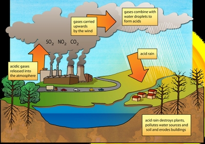

## Atmospheric Pollution and its Causes

* Atmospheric pollution happens when the atmosphere contains harmful amounts of gases and substances. These substances are called pollutants
  * **Primary pollutant**: a pollutant that is emitted directly from the source

  * **Secondary pollutant**: a pollutant that forms through chemical reactions with primary pollutants

### **Smog**

* Burning of fossil fuels in industry, homes, and vehicles provides particles like smoke and dust for fog to form around.
* **Photochemical smog:** involves chemical reactions induced by sunlight on certain pollutants that converts them into harmful substances such as ground-level or tropospheric ozone.
  * Occurs in warm and sunny conditions
* Vehicles are a major source of particulate matter (PM) and volatile organic compounds (VOCs), which cause photochemical smog.
  * **Particulate matter (PM):** a mixture of very small particles and liquid droplets suspended in the air. Can be derived from humans or nature, e.g. fuel combustion and sea sprays

  * **Volatile organic compounds (VOCs):** organic compounds with high vapor pressure due to low boiling point, that easily enter the atmosphere as gases, mainly from evaporation

    * Examples: hydrocarbons (methane), ammonium nitrate, carbon monoxide (incomplete combustion), petro, formaldehyde (from paints, scents, cleaning products)

  * Emissions of volatile organic compounds result from the incomplete combustion of fuel, leakages from petrol tankers and fuel tanks, etc.
* When ammonium nitrate from fertilisers and manure is carried in the air, it can cause **agriculture smog.**
* **Temperature** **inversion**: a weather condition when the air temperature increases with altitude rather than decreasing. Traps and increases the concentration of smog.
* Conditions required for a temperature inversion include:
  * High air pressure (anticyclone), which causes the upper air to sink
  * Calm conditions resulting from high pressure (since wind can disperse smog)
  * Valleys surrounded by steep-sided hills, trapping the smog

### **Acid rain**

* Acid rain is precipitation with a pH value of less than 6.

* Burning of fossil fuels in factories and power stations release sulfur dioxide and nitrogen oxides, vehicle emissions add further nitrogen oxides. This is dry deposition

* When these gases mix and react with the water vapour in the atmosphere, they form weak nitric and sulfuric acid solutions, which can be moved by wind.

* They eventually fall to Earth as acid rain. This can happen a little away from the source. This is wet deposition

### **Ozone Layer Depletion**

* The ozone layer protects the Earth from the Sun’s harmful radiation.
* It is formed when oxygen (O$_2$) filters from the top of the
  troposphere and reacts under the influence of ultraviolet radiation
  to form ozone (O$_3$).
* The stratosphere's ozone is continually being produced, destroyed and replaced by this chemical process, creating a dynamic balance between our atmosphere and ultraviolet radiation.
* This chemical reaction is at its greatest above the equator and the tropics, but is distributed to other regions by the wind in the stratosphere.
* The concentration of ozone falls due to human activity, disrupting the natural balance.
  * Chlorine is found in the chlorofluorocarbons (CFCs) released by plastic manufacturing, air cooling systems, refrigeration fluid and aerosol sprays.
  * When CFCs reach the stratosphere, the ultraviolet radiation breaks them down, releasing chlorine.
  * Chlorine reacts with oxygen in a destructive process, breaking down the ozone molecules to chlorine monoxide and oxygen, depleting the layer and forming a hole.
  * This hole allows harmful radiation to enter the Earth’s atmosphere.

### **Enhanced greenhouse effect**

* Enhanced greenhouse effect is created by adding greenhouse gases to the atmosphere through human activities.
* More heat is retained in the atmosphere and an increase in the  temperature of Earth's surface,  leads to global warming and climate change.

**The increase in these gases is because of human activities:**

|Greenhouse gas|Human activities that increase their abundance|
|:---|:---|
|carbon dioxide|Burning of fossil fuels; Deforestation.|
|methane|Cattle and rice production; Coal mine ventilation; Deforestation; Decomposing waste (landfill sites).|
|CFCs|Aerosol sprays; Fire extinguishers; Refrigeration; Air conditioning.|
|Nitrogen Oxides|Vehicle exhausts; Chemical fertilisers.|
|Tropospheric ozone|Chemical reactions involving nitrogen oxides and unburnt fuel vapours.|
