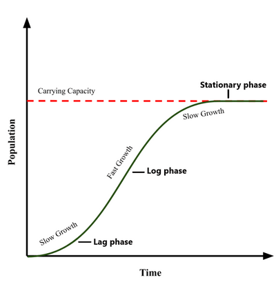
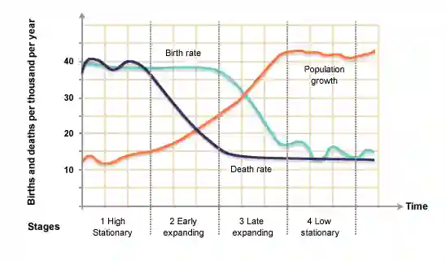
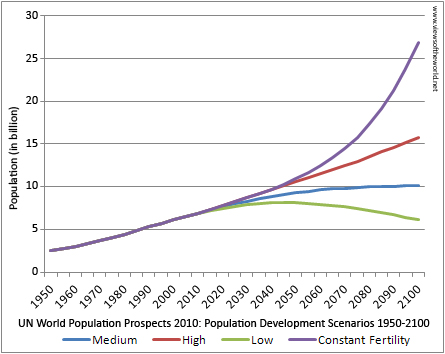
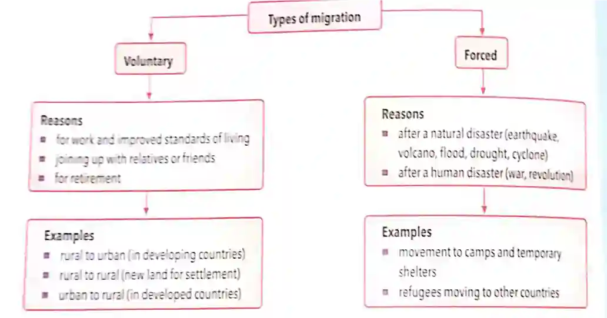

## Changes in Population Size

* **Population:** all the organisms of one species living in a defined area at the same time.

### Population growth curve

* A graphical representation of how the population size changes over time.

* Consists of 3 phases/stages:

  1. Lag phase: the period in population growth when an organism is adapting to its new environment and the growth is slow.

  2. Log/Exponential phase: when the growth rate of a population increases over time as all requirements are in superabundance.

  3. Stationary phase: when the growth rate of a population has slowed down to zero as the carrying capacity is reached.

* Ways to interpret a population growth curve:

  * J-shaped curve = exponential growth; population's growth rate is constant, regardless of size

  * S (Sigmoid) shaped curve = logistic growth; population reaches carrying capacity due to environmental factors

* **Carrying capacity:** the maximum size of a population that an environment can support in terms of food, water and other resources.

* A demographic transition model is a line graph showing the relationship between birth and death rates of a country over time

### **History of human population**

* About 10,000 years ago, about 5 million people were living as hunter-gatherers.

**Significant points in the growth of the human population since then are:**

* About 6,000 years ago, humans started growing crops and rearing animals, which provided more food and allowed the population to begin to grow

* By the time the modern system of counting years started, the population was about 250 million

* It then took another 1800 years to reach 1 billion

* After this, the growth becomes very rapid

* By 1930, it was 2 billion

* By 1975, it was 4 billion

* By 2016, it was over 7 billion, a rise of 3 billion in just 37 years

* UN predictions for the human population in 2100 based on evidence:

### **Birth and Death rate**

* **Birth rate:** the number of live births per thousand of the population per year.
* **Fertility rate**: average number of children born to a woman in her lifetime.
* **Death rate/Mortality rate:** the number of deaths per thousand of the population per year.
  * Formula: $\frac{\text{number of deaths}}{\text{total population}}$
* **Infant mortality rate**: number of deaths of children under one year old, per 1000 people
* **Natural increase:** the difference between birth rate and death rate.

#### **Factors affecting birth rate:**

* **Family planning** - contraception, abortion, sterilisation, even tho it is ultimately a couple’s choice, but governments can intervene, e.g. providing free contraception or making it unavailable

* **Improved health and education** - education can create tendencies of late marriages and late child bearing, but aids in better family planning. Better health care decreases infant mortality, increases birth rates.

* **National population policies - pronatalist policies** (government encouraging increased childbirth, through benefits and pensions) and **anti-natalist policies** (discouraging childbirth through provision of family planning, contraceptives and education, to laws limiting number of children)

#### **Factors affecting death rate:**

* **Healthcare & Living Standards:** Limited access to medical services, poor sanitation, and low living standards raise death rates.

* **Nutrition & Clean Water:** Malnutrition and lack of safe drinking water, especially among children and women, increase disease risk.

* **Disease Burden:** High prevalence of infectious diseases (e.g., malaria, HIV/AIDS) significantly impacts mortality.

* **Conflict & Crime:** War and high violent crime rates threaten lives and public health.

* **Population Structure:** A larger elderly population or imbalanced sex ratio can influence overall death rates.

* **Economic Conditions:** Poorer economies (LEDCs) often struggle with healthcare, nutrition, and basic services, leading to higher mortality.

**Migration**

* **Migration:** the movement of people into (immigration) or out of (emigration) a region, country or area.
* The most common worldwide movement is from rural to urban areas in LEDCs.
* Sometimes, urban-to-rural migrations also occur, mostly in MEDCs.
* **Population growth: (birth rate \+ immigration) – (death rate \+ emigration)**

|Push factors: factors that encourage people to move away from an area.|Pull factors: factors that encourage people to move into an area.|
|:---|:---|
|**Drought/famine;**|Good supplies of food, whatever the weather;|
|**Poverty;**|Well-paid jobs;|
|**Poor links with the outside world;**|Good roads;|
|**Poor services;**|Hospitals, schools, water, electricity;|
|**Work on the land only, subsistence;**|Factory, shops, and office work for a wage.|
|**Desertification;**|No comparable pull factors|
|**Sea-level rise;**|No comparable pull factors|
|**Seasonal weather events.**|No comparable pull factors|
