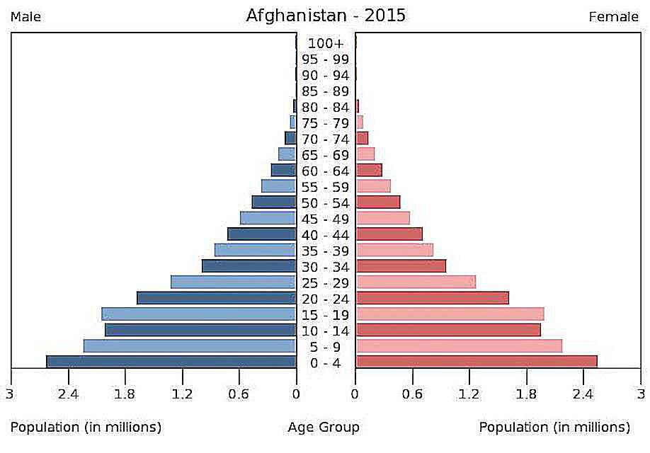
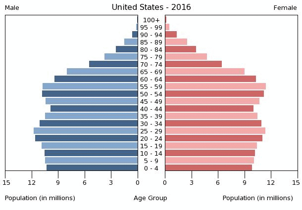
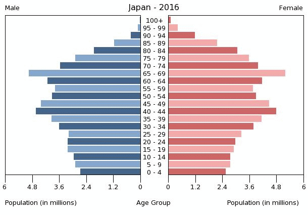

## Population Structure

* Population structure is a composition of a population based on the demographic (made up of age and gender) of a country that is shown on a population pyramid.

  * It can be viewed as the outcome of an organism's history and its adaptation to the environment.

  * A population structure can be crucial for many fields, including ecology, genetics, public health, etc.

### **Population/age pyramid:**

* A diagram that shows the proportion of
  the population that is male and female in different age groups
  (usually 5-year interval).

* How to interpret a population pyramid:

1. Look at the base:

   - if wide, means more children hence high BR
   - if narrow, low BR

2. Look at the top:

   - high and wide = high old people numbers, which means longer life expectancy
   - narrow and low point = low life expectancy

3. Look for the overall shape

   - triangle shape = developing country
   - straight = developed country

4. Separate out age groups

   - 0 to 14 = non-working population
   - 15 to 64 = working population
   - 65 to 100 = retirees/no longer working

5. Quote supporting percentages to the description

#### Dependency ratio:

* The ratio between those of non-working age (the dependents), who rely on taxes to support them and the working age (economically active) who pay for the taxes. 

* For example, to fund government pensions and the costs of public services such as education and medical care

* Knowing the numbers in these three cohorts enables the dependency ratio of a population to be calculated

* **Dependency Ratio Examples:**

  * **1:1** – 20 million dependents out of 40 million people

  * **2:1** – 20 million dependents out of 60 million people

  * **1:2** – 60 million dependents out of 90 million people

* **Key Points:**

  * **Low dependency ratio** (more workers per dependent) is beneficial — tax burden is shared, and services are easier to fund.

  * **High dependency ratio** (fewer workers per dependent) can strain the economy, may lead to higher taxes and cuts in public services.

### **Expansive Population Pyramid:**

* Characterized by a wide base (many young people) and a narrow top (few elderly).

* Indicates **high birth rates** and **high death rates** — typical of **developing countries**.

* **Example:** Afghanistan (2015) shows a classic LEDC pyramid with a large youth population due to high birth rates.

### **Stationary/Stable Population Pyramid:**

* Resembles a column or rectangle, with similar numbers across most age groups.

* Indicates **stable birth and death rates**, common in **developed countries** with **slow or no population growth**.

* **Example:** USA (2016) shows a nearly stationary pyramid, with a slight taper at the top due to elderly mortality.

### **Constrictive Population Pyramid:**

* Narrow base and wider top indicate **low birth rates** and **high life expectancy**.

* Typical in countries with **aging populations** and **shrinking population size**.

* **Example:** Japan (2016) shows a constrictive pyramid, with a large elderly population and declining birth rates.

* **Dependent:** those people in the population who are not economically active (working), i.e., the young (<16) and old (65+) and thus rely on those who are working for their needs.
* **Independent:** those people in the population who are economically active (working), i.e., the middle-aged (between 17 and 65).
* **Taxes from the independent population are used for:**
  * Education for the youngsters and provision of school places for the
    children yet to reach school age.‎

  * Creating care-home places and hospitals for the aging population.‎