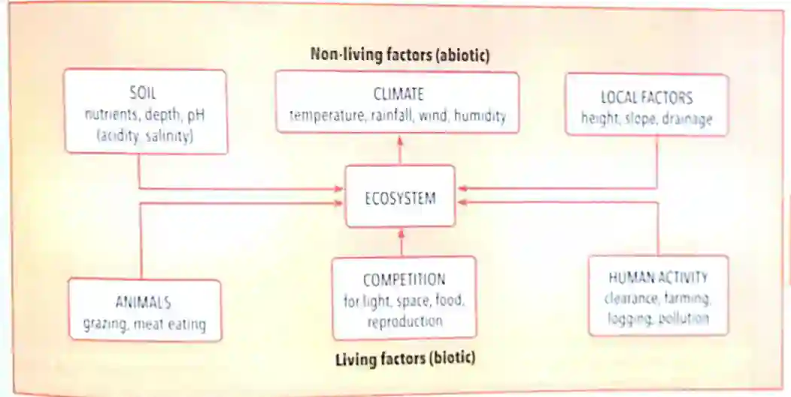
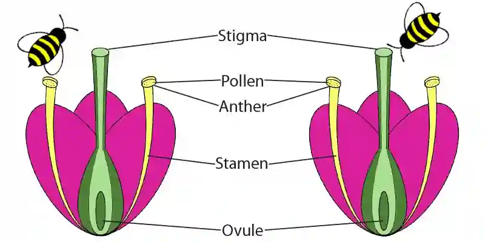
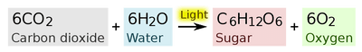
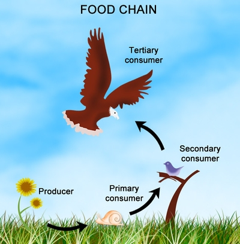
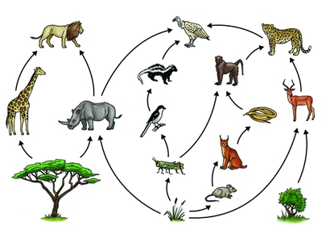
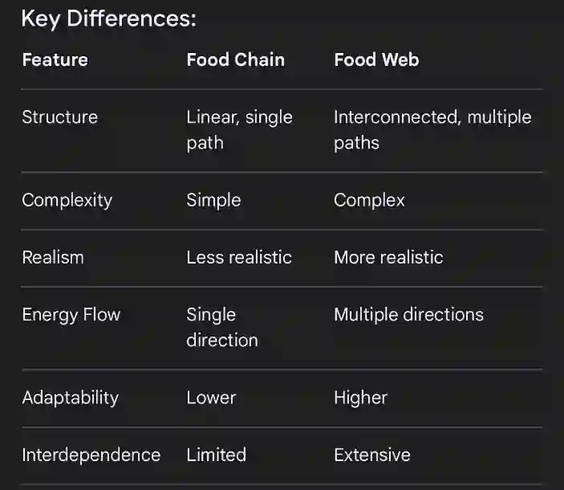
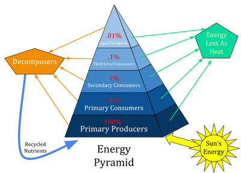
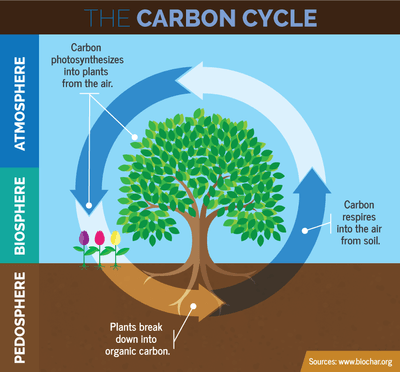

# Natural Ecosystems and Human Activities

## Ecosystems

* **Ecosystem:** all the living things (biotic components) together
  with all the non-living things (abiotic components) in an area.

**Ecosystem structure**

* Living things in an ecosystem can be at different levels.
* **Population:** all the organisms of one species living in a defined area at the same time, e.g. population of tigers in a rainforest
* **Community:** a group of populations of different species that live together in an area and interact with each other, e.g. all animal species in forests.
* **Habitat:** the place within an ecosystem where an organism lives, finds food and reproduces.
* **Niche:** the role of a species within the ecosystem.

### **Biotic and Abiotic components**

**Biotic factors:**

* **Producers:** organisms within an ecosystem that can carry out
  photosynthesis or make food on their own.
* **Primary consumers:** organisms within an ecosystem that derive their food from producers.
* **Secondary consumers:** organisms within an ecosystem that derive their food from primary consumers.
* **Tertiary consumers:** organisms within an ecosystem that derive their food from secondary consumers.
* **Decomposers:** organisms within an ecosystem that derive their food from the bodies of dead organisms.

**Abiotic factors:**

* Effect living things and are affected by them.
* **Temperature:** usually expressed in °C. Living things have a range
  of temperatures within which they can survive.
* **Humidity:** a measure of how damp the air is, how much water
  vapour it holds.
  * Usually expressed as relative humidity (RH) – RH expresses the
    humidity as a % of the amount of water vapour the air could
    hold, if fully saturated.
* **Water:** essential for all life as it’s a raw material for
  photosynthesis and a medium for chemical reactions.
  * Plants obtain water from the soil, and the water content of the soil is an important factor in determining where exactly a plant species lives.
* **Oxygen:** nearly 21% in the air; decreases with increasing altitude.
  * Not very soluble in water, so all aquatic organisms have adaptations to get enough, e.g. gills in fish.
* **Salinity:** how salty something is, measured as ppm or parts per thousand (ppt) or concentration, e.g. milligrams/litre)
  * Usually expressed as parts per million (ppm) in water.

  * **Brackish water:** salty water (>0ppt) but not as salty as seawater (<35ppt).
* **Light:** essential for photosynthesis; expressed as lumens.
* **pH:** important factor for plants. Some plants requirie soil with an acidic water content. Other plants cannot survive in the acidic soils at all.

**Figure: The living and non-living components of an ecosystem**

### Biotic interactions

* **Competition:** living things need a range of resources from the
  environment.
  * More young ones are produced than will survive, so there is often competition for resources.
  * Individuals least adapted to the current conditions will die or fail to reproduce.
* **Predation:** when one animal eats another.
* **Pollination:** the transfer of pollen grains (male gametes) from the anther to the stigma for it to fuse with the ovule (female gamete).
  * In plants, male sex cells are found in pollen grains made in the anther.
  * Pollen grains are either blown by wind or carried by insects.
  * The nectaries, found near the base of the carpel, produce nectar, which attracts animals with bright colours and scent. The anther, part of the stamen, is responsible for producing pollen.
  * The pollen grain lands on the stigma of another flower and
    sends out a tube that grows down to where the ovule is.
  * The ovule is then fertilised to form an embryo in a seed that
    grows into a plant.

**Figure: Pollination & Parts of a Flower**

### **Photosynthesis:**

* Plants trap light energy with the help of chlorophyll.
  * This green pigment splits water into hydrogen and oxygen.
  * The hydrogen is added to CO$_2$ to make glucose.
  * The oxygen not used in respiration is given off to the
    atmosphere.
* Plants obtain CO$_2$ from the atmosphere through their stomata in the leaves and water from the soil through their roots.
* Plants in respiration use glucose to release energy, and it is converted to substances the plant needs, e.g. starch, cellulose, proteins, etc.
* Nitrogen is needed to form some substances, such as proteins, but in every case, chemical energy remains stored in the substance.

### **Energy flows and nutrient cycles**

* **Respiration:** the process by which living things release energy from food to carry out the process of life, such as movement.

$$

\text{Glucose} +\text{Oxygen} \rightarrow \text{Carbon dioxide} + \text{Water} +

\text{Energy}

$$

* Glucose and oxygen are used during respiration, water and carbon dioxide are waste products (energy is not a substance).
* Only energy in materials that the plant doesn’t use is available to consumers.

#### **Food chain**

* A diagram showing the relationship between a single
  producer and primary, secondary and tertiary consumers.

* Food chains are typically represented by straight lines showcasing a direct, single, linear path of energy flow.

* Energy is lost at each trophic level due to respiration, excretion and egestion. Only 10% of energy is passed onto next level.

#### **Food web**

* A diagram showing the relationship between all (or
  most of the producers, primary, secondary and tertiary consumers in
  an ecosystem.

* Food web represents multiple interconnected food chains

**Figure: Differences between food chain and  a food-web**

* **Trophic level:** a feeding level within a food chain or food web.
* **Pyramid of numbers:** a diagram that represents the number of
  organisms at each trophic level in an ecosystem by a horizontal bar
  whose length is proportional to the numbers at that level.
* The pyramid shape reflects the loss of energy at each trophic level.
* Plants receives 100% of the energy produced by respiration, some of it is used, some of it is given off as heat.
* Only 10% of the energy that in plants is available for consumption by primary consumers, the same happens to the next trophic level, where only 1% of the energy is being received by secondary, this forms the **pyramid of energy/numbers.**

* **Energy is:**
  * Lost during transfer as heat to the environment
  * Used for cellular respiration
  * Used for growth
  * Lost as faeces
  * Lost by incomplete digestion by higher trophic level
  * Food chains cannot have more than 4 or 5 trophic levels as there’s not enough energy to pass on

### **The Carbon Cycle:**

