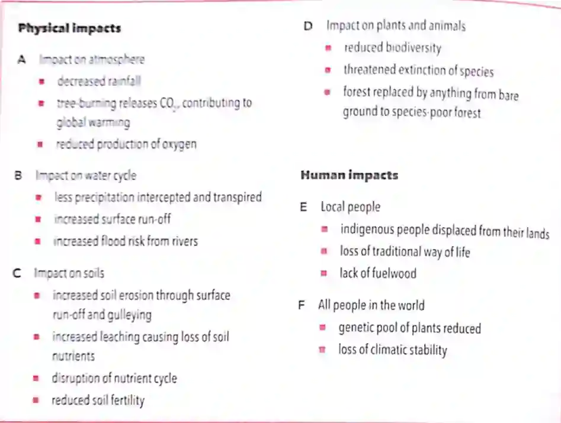

## Deforestation

**Causes of deforestation:**

* Timber is needed in MEDCs for products ranging from luxury furniture to paper or as a source of energy
* Lumber (planks and boards)
* **Clear land for:**
  * subsistence and commercial farming and ranching
  * Roads and settlements (logging tends to be selective as only a few species create timber; however, building roads for transporting logs is the most damaging process.)
  * Rock and mineral extraction

### **Impacts of deforestation:**

**Figure: Impacts of deforestation**

#### **Habitat loss**

* Biodiversity is lost when habitats are lost.

* Tropical rainforests are centres of great biodiversity, so loss of habitat here is serious.

* Huge volume of trees acts as massive carbon stores that are also home to rare species which may be useful to us.

#### **Soil erosion and desertification:**

* Forests reduce the impact of heavy rainfall on the ground, reducing soil erosion.
* Tree roots bind the soil in place, and the layer of fallen leaves and branches protects the soil.
* Over time, after deforestation, the area that once supported luxuriant growth may become a desert because of desertification.
* The forest reduces the impact of heavy rainfall on the ground, roots hold soil in place and leaves and branches act as a barrier for soil, reducing soil erosion.

#### **Climate change:**

* Changes caused in the levels of various greenhouse gases in
  the atmosphere.
* CO$_2$ and methane are rising, and so are atmospheric temperatures.
* **Greenhouse gas:** gas that stops energy in the form of heat from being lost from the atmosphere.
* Rise in CO$_2$, due to the burning of fossil fuels, deforestation, industries.
* If the rate of trees photosynthesising and respiring were equal, removal of trees would have no effect.
* However, permanent removal of trees leads to large quantities of CO$_2$ when burnt or decomposed.
* Moreover, the machinery of burning fossil fuels releases more CO$_2$.
* Loss of biodiversity and genetic depletion