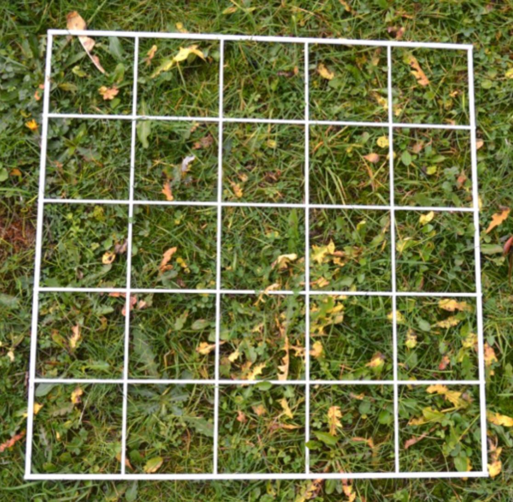
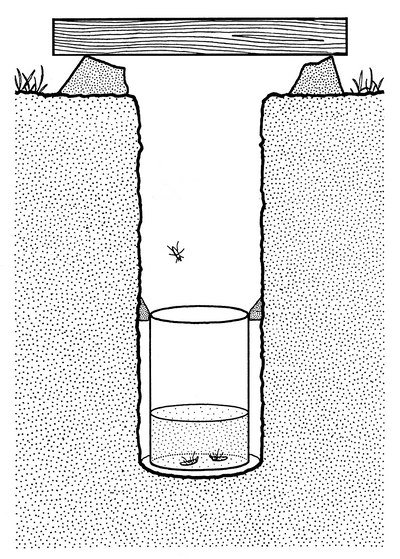
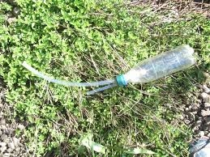
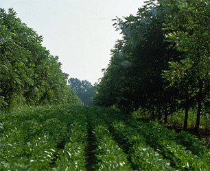
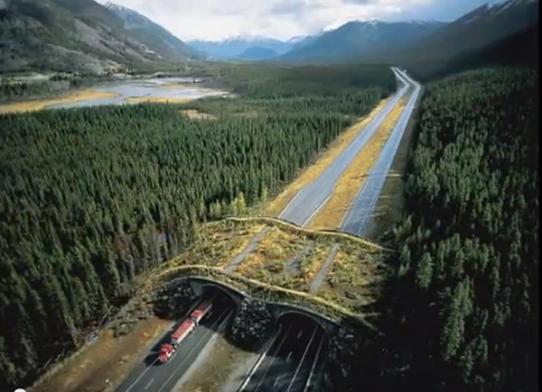
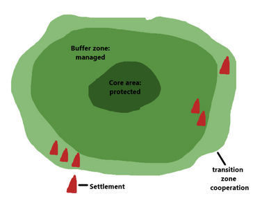

## Measuring and Managing Biodiversity

### **Measuring biodiversity:**

**Sampling sedentary organisms: quadrats and transects**

* **Quadrat:** a frame of the known area placed on a part of the site to be sampled.
  * Used to sample sedentary organisms e.g. plants.
  * The number of organisms of the species is then counted.
  * Sometimes, the percentage cover of the organism in the quadrat
    is calculated. Example of a simple scales is ACFOR: Abundant, common, frequent, occasional, rare.

* **Important when placing quadrats to consider where it is being placed:**

  * If two areas are to be compared, the quadrat should be placed randomly in each, which is called **random sampling**.

  * If the aim is to see how the species change along a gradient in the environment, quadrat should be placed along a line called **transect**, which is systematic sampling.

* **Transect:** a sampling method in which sampling devices are laid out along a grid map of an area.

  1. Select a starting point

  2. Count all organisms along the transect or at regular intervals using quadrats

  3. Record the results in a table

  4. Repeat the transect in different positions in the same field

  5. Calculate average number of organisms for the whole field

* **Systematic sampling**: a sampling method in which the sampling device is placed along a line or a pre-determined pattern, usually a transect.

**Sampling mobile organisms: pitfall traps and pooters**

* For mobile organisms (e.g. animals), trapping methods are used to estimate biodiversity as well as population size.
* **Pitfall traps:**
  * Used to sample non-sedentary organisms (insects).
  * Consists of a jar sunk up to its rim (or deeper) in the soil.
  * The jar may or may not be covered (depending on the predicted
    likelihood of rainfall).
  * Traps should be inspected and emptied regularly.
  * It can be used randomly or systematically.
  * **Drawback**: Pitfall traps measure the *activity density* of species, not the true population size.

* **Pooter:**
  * Used to sample non-sedentary organisms e.g. insects.
  * Insects in short vegetation or on trees are usually trapped in a net.
  * For example, a pooter is used to transport the organisms from the nets or traps to a laboratory.
  * How they work,  2 tubs are inserted into a container, one is used to suck air through (contains mesh on the other end, inside the container to prevent sects from being sucked in), and the other is used to suck the insect inside the container

**When to use random or systematic sampling:**

* If the investigation is looking at how distribution changes over an environmental gradient $\rightarrow$ systematic sampling.

* If your investigation requires you to compare areas $\rightarrow$ random sampling

|Method|Advantages|Disadvantages|
|:---|:---|:---|
|quadrats|Quick; Inexpensive, Portable.|Not always very accurate; Unless many quadrats are placed, the sample can be unintentionally biased.|
|transects|Quick; Inexpensive, Portable.|Often used in inappropriate situations.|
|pitfall traps|Inexpensive; Easy to set up and use.|Often kill the organisms captured; May oversample or undersample.|

### **Sustainable harvesting of wild plant and animal species, sustainable forestry and agroforestry**

**Sustainable harvesting of wild plant and animal species:**

* Many plants have medicinal properties because of the secondary metabolites they produce.
  * **Secondary metabolites**: organic compounds produced by bacteria, fungi, or plants that are not directly involved in the normal growth, development, or reproduction of the organism.
* Wild plants are the preferred source because cultivated varieties only produce small or none of the chemicals used.
* **Management plan to control the harvesting of wild-grown medicinal Plants:**
  * Assessing the abundance of the plant (refer to section 9.5 Measuring and managing biodiversity).

  * Investigate species’ growth rate, reproductive biology and impact of harvesting.

  * Investigation can help assess the yield that the wild population can sustain.

  * Details of how the harvesting should be monitored.

**Sustainable forestry:**

* **Selective logging:** removal of only mature trees of species that are valuable. Other species and immature trees of value species are left, allowing the forest to repair over time.
  * Non-valued trees still provide habitat for many species and immature valued trees can be used years later.
* **Advantages of selective logging**:
  * Selective logging causes less damage to forest than excessive logging

  * Provides job opportunities

  * Extraction is sustainable

**Agroforestry:**

* **Agroforestry:** land management system in which crops are grown around trees.

* Trees enrich the soil when the leaves fall and provide food for animals, firewood for people, and sometimes medicine.

* Tree roots bind the soil together and, in some cases, fix nitrogen, further enriching the soil.

* Farmers obtain food and milk from the farm, and their animals
  enrich the soil with manure.

* **Alley cropping:** planting rows of trees at wide spacings with a companion crop grown in the alleyways between the rows. Is a form of agroforestry

* Trees are pruned, and the prunings are used to improve the soil and provide minerals to the crop. (if the tree is a legume, these minerals would include nitrates)

* Mineral recycling and the suppression of weeds by trees are combined with cropping on the same land, thereby allowing the long-term survival of farmland.

**National parks, wildlife and ecological reserves and corridors:**

* **National parks:** an area of land protected by the government to preserve entire ecosystems e.g. flora, fauna and landscape.

  * Laws that ban/limit activities such as hunting, logging and collection of wildflowers are implemented.

  * Enforcement requires regular inspection and threat of hefty fines or imprisonment for breaking the law.

  * Extensive tourist facilities are provided, including roadways, car parks and natural trails.

  * An entry fee is charged for conservation work.

  * A guidebook/leaflet includes information on the dos and don’ts and the importance of the conservation of wild nature.

  * The largest national park in the world is the Northeast Greenland National park, covering 972001km^2.

* **Wildlife and ecological reserves:** the practice of protecting wild plant and animal species and their habitat that plays an important role in balancing the ecosystems and different natural processes e.g. rainfall, soil fertility, etc., thus also meeting the needs of people.

* **Extractive reserves:** an area of land, generally state-owned where access and use rights, including natural resource extraction, are allocated to local groups or communities.

* **Wildlife corridor:** a link of wildlife habitat, generally native vegetation, which joins two or more larger areas of similar wildlife habitat.

* Corridors are critical for the maintenance of ecological processes
  including allowing for the movement of animals and the continuation
  of viable populations.

* **World biosphere reserves:** an ecosystem with plants and animals
  of unusual scientific and natural interest.

* The plan is to promote management, research and education in
  ecosystem conservation.

|Core area|Buffer zone|Transition zone|
|:---|:---|:---|
|**Ecosystems that need protection.**|More research, along with tourism and education.|Local communities and conservation organisations work together to manage the area to benefit the people living there.|
|**Monitoring and some research.**|It may contain field stations with laboratories and recreational facilities.||

* **Advantages:**
  * Recognised internationally via UNESCO.
  * Attracts funding and support of experts in the conservation
    community, improving the success of the reserve

**Seed banks**

* **Seed banks:** store seeds to preserve genetic diversity when it’s not possible to protect the area where the endangered plant lives.
  * Seeds are collected from individual banks, higher diversity than if they were collected from a single plant.

  * Seeds are x-rayed to check for healthy embryos, helps to select only fit for storage seeds.

  * Seeds are dried to remove water, this increases the time seeds can be stored and remain alive.

  * Seeds stored in cold temperature (-20°C)

  * Some seeds are tested (by planting) to see if they can germinate and grow, the ones that are still good can be re-stored.
* Wild plants carry genes that could be used in crop plants to confer
  resistance to pests and diseases
* Seeds occupy less space than plants. Thus, more species can be held
* Collecting small samples of seeds is unlikely to damage the wild population, as most plants produce numerous seeds
* Seeds are dormant and need minimal care, thus easier to store than
  living plants

**Role of zoos and captive breeding:**

* Provide education about the illegal trade in animals and products, and the need to maintain biodiversity
* Involved in scientific research on the control of diseases, animal behaviour and techniques to improve breeding success
* Captive-breeding programs increase species numbers, thus reducing the risk of extinction
* Aim to release captive-bred animals into the wild when habitats have been restored
* Such programs try to maintain the genetic biodiversity of a species, as interbreeding leads to a reduction in diversity and therefore reduces badaptability when the species is placed back in the wild.
* **Ways to reduce inbreeding:**
* Organisms aren’t allowed to breed repeatedly with the same partner
* A variety of partners for an organism can be achieved through in-vitro fertilisation and inter-zoo swapping of individuals
* Use a database (studbook) to record the breeding history of individuals in captivity.

**Sustainable tourism and ecotourism**

* **Sustainable tourism and ecotourism:** management of tourism in a
  sustainable way to prevent damage to habitat and provide what people
  want.
* Key to successful sustainable ecotourism is realising that the
  growth of the tourist industry depends on maintaining the
  environment.
* Measures are taken to safeguard wildlife, and the resources are used sustainably.