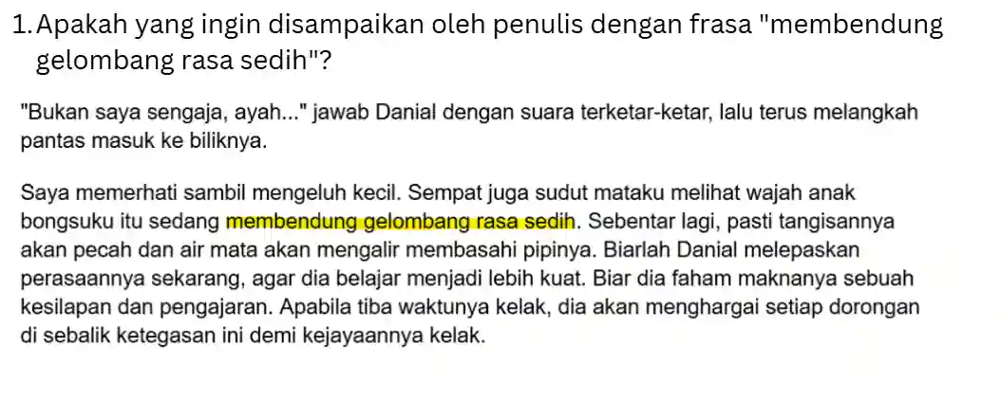
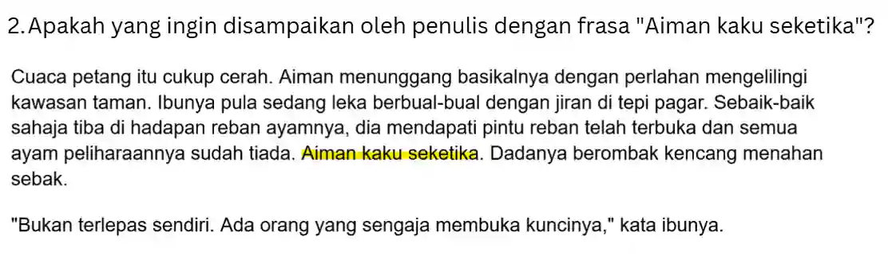
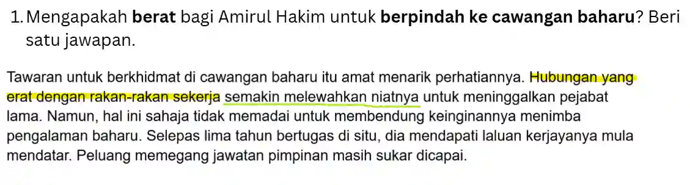
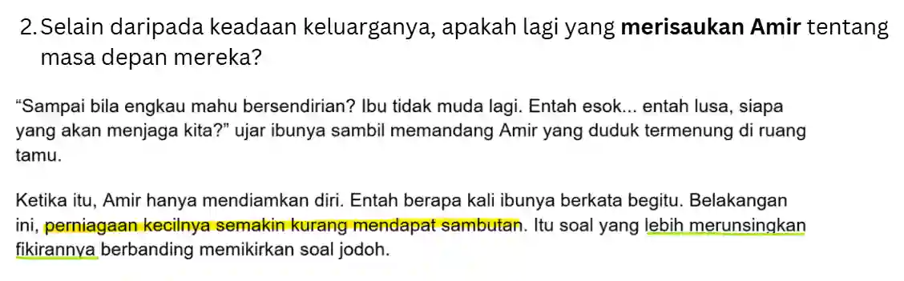

## Implicit And Explicit Meaning

### Implicit

* These answers have to come from **you**

* In recent years (2024-2026), some questions ask for the overall lesson/short summary from the text

  * Reread the entire text to look for answers

  * These questions are normally worth **3 marks**

* Questions on these normally ask for the writer’s feelings or the effect of a certain adjective

* These questions are normally on the last part and can be worth up to **10 marks**

  ---

  

  As you can see, there is no direct answer to this question, but you can infer that the character was trying to hold in her tears. Thus, the answer is “**dia sedang menahan daripada         menangis**”.

  ---

  

  In this question, they asked why Aiman was at a loss for words. Think about when you will be at a loss for words (surprised, disappointed, sad) and pick the one that fits the context most. Thus, the answer is “**Munah terlalu terkejut (surprised)**”.

---

### Explicit

* These answers can be easily found in the text

* Identify the keywords in the question and look for them in Text A

* These questions are normally the first few and main questions in Section A

* The answer is normally within the same sentence/paragraph

  ---

  

  The keywords in this question are “berat” and “berpindah ke cawangan baharu”. Thus, look for a similar phrase in the insert, which is “semakin melewahkan niatnya”. Thus, the answer to this question is “**Hubungan yang erat dengan rakan-rakan sekerja**”.

  ---

  

  The keyword in this question is “merisaukan Munah,” and the phrase “lebih merunsingkan fikirannya” is similar. Thus, the answer to this question is “**perniagaan kecilnya yang semakin kurang mendapat sambutan**”.

  ---