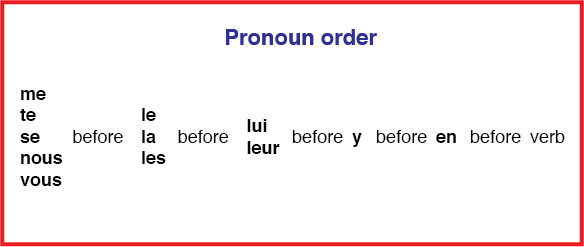
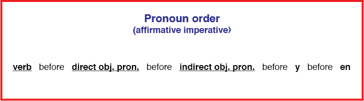

## Pronoun Order

* When using object pronouns, it is important to know that there is a specific order
* The same type of pronouns cannot be used more than once in the same sentence
* Two different pronouns can only be used in a single sentence
* The negation part *Ne* always before everything
* **Note:** This diagram demonstrate the order only for normal sentences excluding the affirmative imperative. The negative imperative still follows this order.

 

**Examples:**

* Je le lui ai donné. (I gave it to him/her.)
* Il me les montre. (He is showing them to me.)
* Ne me mens pas ! (Don’t lie to me!)

---

* However, It is different for the affirmative imperative
* The disjunctive/stressed pronouns *moi* and *toi* are used instead of *me* and *te*. This also applies to imperative with reflexive verbs.

 

**Examples:**

* Achète-moi une maison ! (Buy me a house!)
* Donne-le-moi ! (Give it to me!)
* Parle m’en ! (Talk to me about it!)
* **Note:** *moi* and *toi* when met with *en* and *y* become *me* and *te* and contract to *m’* and *t’*

