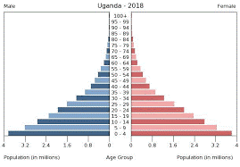

## Population structure

### **A country with a high dependent population: *Uganda***

**Location and background:**

* Uganda is located in East Africa, with a land area of 197,100
  km2 and a population of 42.86 million.
* It has the world’s youngest population with over 78% of its
  population below the age of 30.

**Causes:**

* The birth rate in Uganda is very high as parents are having more
  children.
* Parents have more children to use as economic producers / help
  in their jobs (agriculture) 
* The infant mortality rate in Uganda is high (45.1 in 2012) so
  parents have more just in case.
* There is a lack of contraception that helps protect against
  pregnancy.

**Effects:**

* A lot of money has to be spent on healthcare as there are more
  births, more vaccinations used and children being ill.
* The GDP will increase as there would be a larger workforce in
  the long term and no laws on child labour
* As there are more kids, more of them would need to be educated,
  there would be more money spent on education.