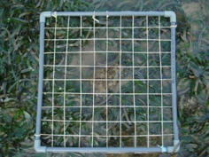
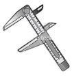
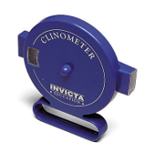
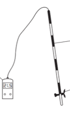
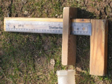
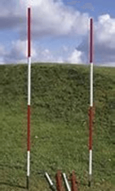

# Fieldwork Equipment

### **Quadrat:**

* Used for measuring vegetation cover. Usually 50cm2 divided into 100 small squares. Placing a quadrat over an area of vegetation can calculate the area covered in vegetation or % of ‎different vegetation types.         

### **Callipers:**

* measure the width, depth or length of small objects like a load.

  

### **Clinometer:**

* used for measuring slope angle (gradient).

### **Flowmeter:**

* used for measuring the velocity of rivers. Have a small propeller, which you place just under ‎the water's surface. Depending on the speed of the propeller, a small digital readout gives the speed ‎of the river.‎

### **Pebbleometer**:

* A fundamental device for measuring the size and shape of material found on a beach or river.

  

### **Ranging Poles**:

* They have a pointy end to properly anchor them into the soil/sand.          