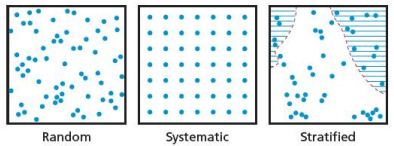

# Sampling Techniques

## Sampling methods:

* It is hard to collect data from the whole population hence geographers do sampling which is the process of collecting data from certain people which represent the whole population.
* There are three types of sampling techniques:
  * Random sampling.
  * Systematic sampling.
  * Stratified sampling.

