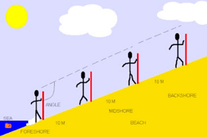

# Methods

## Coasts

### Beach Profile

1. Person A stands at a safe distance from the edge of the sea holding a ranging pole
2. Person B stands holding a second ranging pole further up the beach where there is a break of slope
3. The distance between the two ranging poles is measured using a tape measure
4. The angle between matching markers on each ranging pole is measured using a clinometer
5. Repeat this process at each break of slope until the top of the beach is reached.

### 

### **Longshore Drift**

1. Lay the measuring tape parallel to the coast, next to the water

2. Mark out a 10m section

3. Place a float or an orange in the swash zone at the 5 metre middle mark

4. Record the direction in which the object travels (left or right) and how long it takes to travel 5 metres

5. Repeat the experiment and take an average.

### **Wave Counts**

1. Place a pole in the water
2. Using a stopwatch, count the number of times the waves hit the pole per minute
3. Repeat this 5 times and take the average

### **Material/Trash Count**

1. Place quadrats along the transect/throw the transect over shoulder

2. Count number of squares with different types of beach material/trash

3. Convert to percentage

4. Have multiple people count as well to increase reliability of the findings

   or

5. Use caliper and pebbleometer to measure length and width of the material