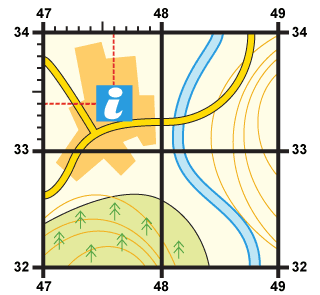
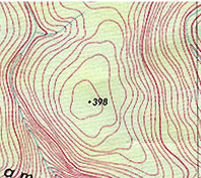

# Topographical Map Skills

## Map

* Walk before you run!
  * Four figure grid reference of the tourist information center is 4733.
  * Six figure grid reference of the tourist information center is 476334.

* Compass points for direction

  ---

  ### **Contours:**

* Contour lines connect points of equal altitude (elevation above sea level) on a map.
* Measure from sea level in meters
* Each contour is in regular intervals
* Spot heights e.g. 398 on trigonometrical points
* Gradient =
  $\frac{Vertical\ Interval\ (difference\ in\ height)\ }{Horizontal\ Equivalent\ (horizontal\ distance)\ }$

Patterns of contours: