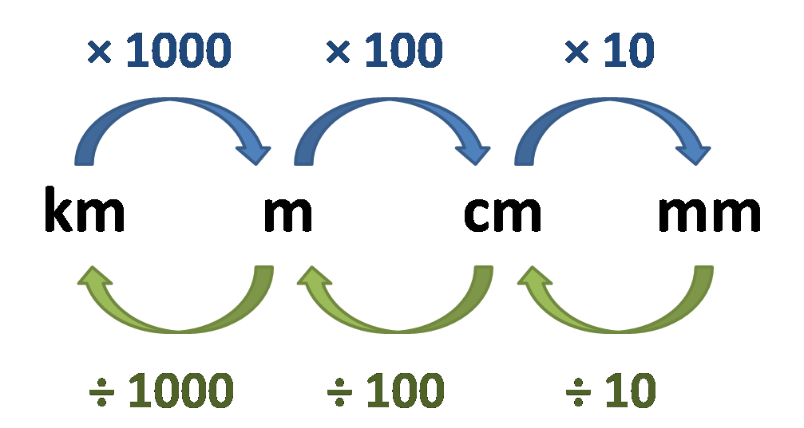

## Distances

### Calculating Distances

* In the IGCSE exams, maps are given at a scale of 1:25000 OR 1:50000. The scale of the map is given on the map itself and also in the exam paper.

* A map with a scale of 1:25000 means that 1 cm on the map is 0.25km. Similarly, a scale of 1:50000 means that 1 cm on the map is 0.5 km.

You also may be asked how to **convert units:**

### Measuring Distances

To measure straight distances, use a **piece of paper** and **the scale given**.

You will also be asked to measure curved distances. You can:

1. by using a piece of paper
2. by using a piece of string

This video teaches you how to measure curved distances:

<https://www.youtube.com/watch?v=goCTtV7vLEc>