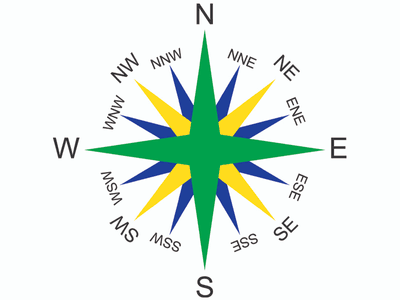

## The Compass rose and bearings

You will be asked to describe the location of features by giving directions.

The IGCSE requires you to give direction on a 16 point compass.

(the 16 point compass)

* Bearings are used to give the direction of a point in degrees, always starting from north.

**This means that:**

* North would be 0° from north (or 000 as a bearing),
* East would be 90° ( written as 090 for bearings),
* South would be 180° ( written as 180),
* West would be 270° (written as a bearing of 270).

### Remember:

1. Each sub-sub-division is 22.5˚
2. Direction is always given in the form of ‘FROM and TO’ statements.
3. Wind is always named as the direction it is blowing from.
4. Rivers always flow from high to low land.
5. When taking compass directions: 0 ̊ must be facing