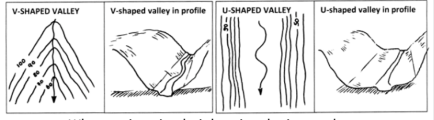
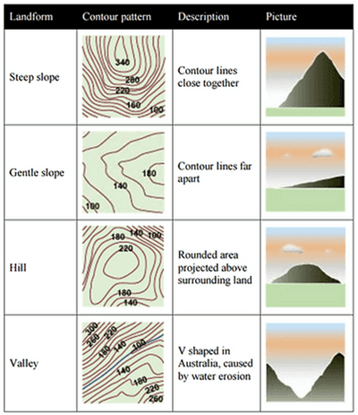
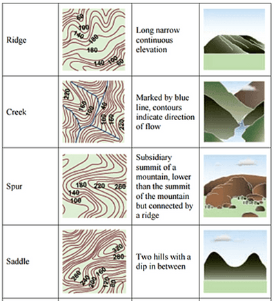
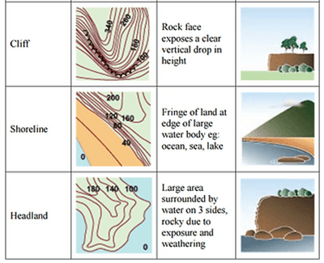

## Describing Patterns

**Relied is the height and shape (flat/steep) of the map**

– (look for spot heights, index and interval contours, shape of contour).

1. Convex slope – contours closer at the bottom
2. Concave slope – contours further apart at bottom
3. Uniform slope – contour decrease evenly.
4. Depressions – height decrease as go into circle.
5. Valleys intrude, ridges protrude:

    