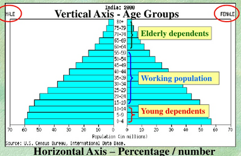
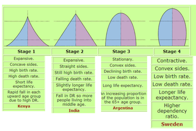

## Population Structure

* **Keywords:**
  * **Ageing population:** Old dependents (people above 60 years old)
  * **Dependent population:** People who don’t work; are retired and have young children.

**Population Pyramid:** a type of graph that shows the age and sex structure of the country; the distribution of age, sex, and population of different countries is known as population structure and is represented on a population pyramid.

 

**Implication of Dependents:**

|    | Too few | Too Many |
|----|----|----|
| Young dependents: | Closure of child-related services; fewer jobs. | Taxes for public schools from the government and more child-related services are needed. |
|    | Fewer consumers and taxpayers in the future and fewer people to take over the working population. | More people in the working population in future hence unemployment. |
|    | An increase in the age of the population | Increased dependency ratio |
|    | Less labour in future | Pressure on healthcare and education |
| Old dependents: | The strain on pension systems; decrease in retirement age. | More pensions to be paid, increased retirement age. |
|    | Population structure changes. | More pressure on public transportation |
|    | Expensive medical and health care. | pressure on healthcare |
|    | Loneliness | Not enough labour force |
|    | Increased residential costs. | Difficult to evacuate old dependents during natural disasters. |

### **Different Types of Population Pyramids**

 