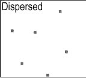
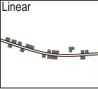
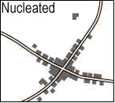
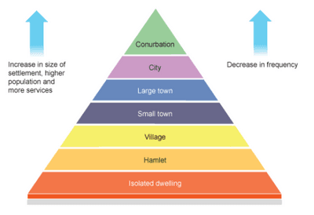

## Settlements (Rural & Urban) and Service Provision

### **Settlement Patterns**

||||
|:---|:---|:---|
|An isolated, building or a group of two or three buildings, separated from the next by 2 or 3 km.|Buildings are strung along a line of communication, for example, a main road, a river valley, or a canal|Buildings are grouped, initially for defence or a common resource.|

* **Site:** describes the physical nature of where a settlement is
  located – the actual piece of land
* **Situation:** describes settlement about other settlements and physical features around it – this determines whether the situation will grow into a large city or remain a small town or village
* **Factors influencing settlements:**
  * Wet point site: this has a good water supply
  * Drypoint site: this has less risk of flooding
  * Building material: availability of stone, wood, clay, etc.
  * Defensive site: in a river meander or on a hill with steep-sided and commanding views
  * Fuel supply: for heating and cooking
  * Food supplies: land suitable for farming
  * Nodal points: where routes converge
  * Bridging point: river shallow enough to build a bridge
  * Aspect: settlements often on the sunny side of a valley
  * Shelter: from cold prevailing winds and rain
  * Climate: A good climate attracts more people.
  * Fertile land: brings in more farmers.
  * Location: access to trades and raw materials.

### **Hierarchy of Settlements**

A **hierarchy** is when settlements are ordered and classified based on:

* Population size.
* Several services were provided.
* Number of settlements.   
* Determining the order of importance:
  * The population size
  * The range and number of services
  * The sphere of influence

---

* **Sphere of Influence:** an area served by a settlement
* **Services:** Facilities that are offered to people, e.g. supermarkets. Services have a threshold population, which helps explain why bigger settlements have more services.
* **Range:** The distance that people are prepared to travel to use a service.
  * **Threshold Population:** The minimum amount of people required for
    a service to be offered and remain open.
  * **High-Order Goods (Comparison):** Goods that people buy less frequently. They tend to be more expensive, and people will normally compare quality and price before purchasing e.g. a car
  * **Low-Order Goods (Convenience):** Goods that people buy every day. They don't usually cost much money, and people would not normally travel far to buy them e.g. bread and milk
  * **Functions of settlements:**
    * **Rural Areas:** have a lot fewer functions than urban areas. The primary purpose of settlements in rural areas usually is agriculture & low-order services. This is because rural areas have fewer people, poorer transport, poorer communication, less technology, & the land is better used for other purposes.
    * **Urban Areas:** tend to have many more functions ranging from shopping to educational, transport, administrative, and residential functions; and more middle and high-order services.
    * **Urban Sprawl:** The spread or growth of an urban area into the rural-urban fringe; provides mainly middle–order services