# Theme 2: The Natural Environment

## Earthquakes and Volcanoes

### **Volcanoes**

A volcano is formed when magma erupts onto the earth’s surface as lava through the vent in the earth's crust.

### **Features of a Volcano**

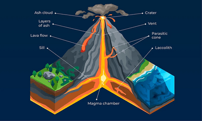

|Feature|Characteristics|
|:---|:---|
|Lava|Magma that reaches the surface|
|Pyroclastic flow|Flow of hot runny lava with gas, ash and volcanic rock|
|Ash|Very fine-grained volcanic material|
|Lahars|Snow and ice melt and combine with the ash, creating lahars.|
|Main vent|Central tube through the volcano|
|Secondary cones|Eruptions from other vents lead to the formation of secondary cones on the sides.|
|Crater|Bowl bowl-shaped basin at the top of the volcano|
|Magma chamber|A large underground pool of magma|

* **How do volcanoes form?**
  * Magma rises through cracks in the Earth’s crust
  * Pressure builds up (inside Earth)
  * Pressure and tension are released → Plate movement
  * Magma explodes to the surface, causing an eruption
  * Lava cools and forms a new crust
  * Over time, rock builds up, and new crusts form on top, forming a volcano.

**Impacts of Volcanic Eruption:**

|Environmental|Human|
|:---|:---|
|Pyroclastic flow|Loss of life and injury|
|lava flow|collapse and destruction of buildings|
|volcanic bombs|transport network damaged|
|Laharas|Loss of jobs and businesses|
|earthquakes|Loss of crops|
|ashfall|Power and water supply damaged|
|landslides||
|Tsunami||
|acid rain||
|ash fallout||

**Opportunities of Volcanos:**

|Fertile soils|The cooled lava contains minerals, leading to a high yield of crops.|
|:---|:---|
|Tourism|Many people want to visit the area and study it.|
|Minerals and precious stones|They can be sold, providing more work and income.|
|Geothermal energy|the magma gives out heat, which can be used to generate geothermal energy.|
|Creating new land areas|once the lava and ash cool forms new fertile land.|

* **Stages of Volcanoes:**
  * **Active:** has erupted recently and is likely to erupt again.
  * **Dormant:** has not erupted recently but may in future
  * **Extinct:** no evidence to erupt again.
* **Types of Volcanoes:**

|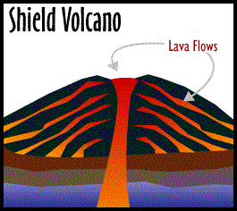|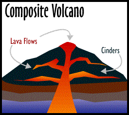|
|:---|:---|
|Low viscosity (runny lava) - basaltic lava|Viscous (thick) - andesitic lava|
|Low in height, gently sloping sides with a broad base|High in height, steep-sided volcanic cones|
|Low silica content (covers long distances)|High silica content (covers short distance)|
|Frequent eruptions but low in magnitude|Rare eruptions but in high magnitude|
|High temperature|Low temperature|
|Low gas content|High gas content|
|There is little build-up pressure.|Enormous build-up pressure|

* **Causes of eruptions:**
  * At constructive margin, plates move away from each other; magma rises to fill the gap;
  * At the destructive margin, oceanic crust melts from friction and heat from the mantle; newly formed magma is lighter, so it rises to the surface

**Distribution of Volcanoes:**

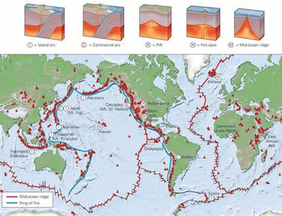

### **Earthquakes**

**Earthquakes**

An earthquake is a sudden violent shaking of ground followed by a series of vibrations or movements in the earth's crust.

* **How earthquakes happen:**
  * Tectonic plates move; they strike.
  * Pressure and tension build up as the plates try to move.
  * Eventually, they jolt free and pressure and tension are released inside the crust as energy.
  * The energy passes through the earth’s crust as waves, an earthquake.
* **Features of earthquake:**

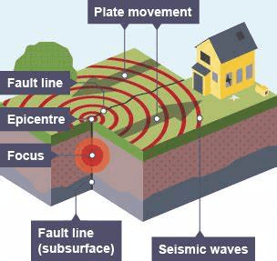

|Features of earthquakes|
|:---|
|Focus: point of earthquake|
|Epicentre: point directly above the focus, on the ground|
|Seismic waves|
|Shaking ground|
|Subduction zone: occurs at a destructive margin; one plate goes under the other|
|Magnitude: the amount of energy released.|

|Effects of earthquakes|
|:---|
|A large number of deaths|
|Fires breaking out|
|Water pipes burst|
|Water contamination, diseases|
|Corpses: human & animal|
|Accessibility difficult|
|Building damaged/destroyed|
|Tsunami can follow|
|Reconstruction costs|

* **Reduce impacts of earthquakes:**

|Prediction|Preparation|
|:---|:---|
|Measure earth tremors, pressure, and release of gas|Build earthquake-proof buildings|
|Use maps and facts to find patterns in time/location|Train emergency services|
|Unusual animal behaviour|Set up a warning system|
|Seismometer|Create evacuation plan|
|Richter scale|Emergency food supply|
||Prepare earthquake kit|

**Earthquake-proof buildings:**

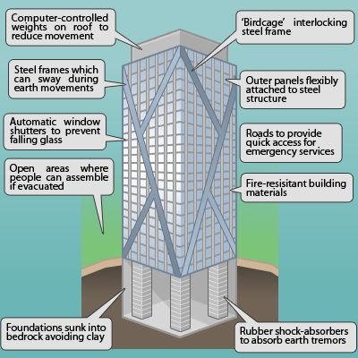

### **Tectonic Plates**

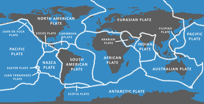

**Types of Plate Boundaries:**

|Diagram|Description|
|:---|:---|
|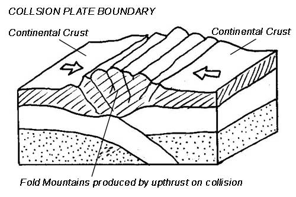|Collision: occurs when two continental plates move towards each other.|
||Example: Indo-Australian and the Eurasian Plate|
|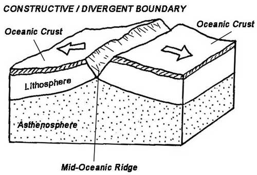|Constructive/divergent: occurs when two plates move away from each other.|
||Example: North American and Eurasian Plate|
|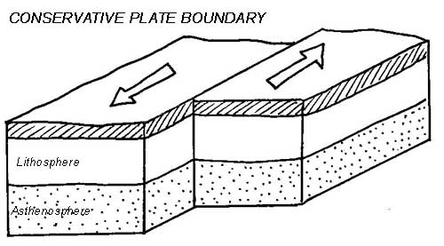|Conservative/transform: occurs when two plates slide past each other.|
||Example: North American Plate and the Pacific Plate|
|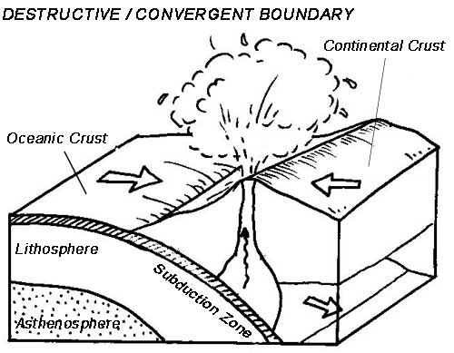|Destructive/subduction/convergent: occurs when a continental plate subducts an oceanic plate.‎|
||Example: pacific plate and the Eurasian plate|

|Plate boundary|Volcanoes|Earthquakes|Fold mountains|
|:---|:---|:---|:---|
|Constructive|Gentle|Gentle|No|
|Destructive|Violent|Violent|Yes|
|Collision|None|Violent|Yes|
|Conservative|None|Violent|No|

### **Structure of the Earth**

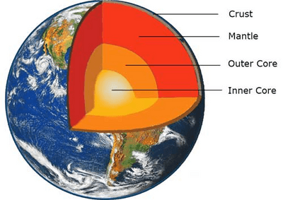

### **Crust**

There are two types of crust:

* The oceanic crust is thinner (5-10km) but heavier and denser
* The continental crust is thicker (25-90km) but is older and less dense.
* The oceanic crust is continually being created and destroyed due to plate movement, where it is denser and subducts under the continental crust.