## Rivers

**The Hydrological Cycle**

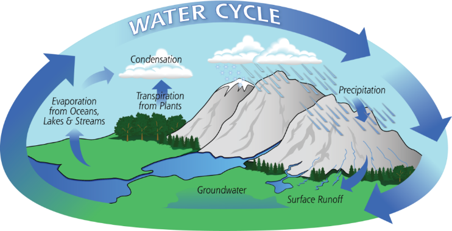

**The hydrological** **cycle** is where water is constantly recycled through the system.

**Drainage basin** - the area of land drained by a river.

 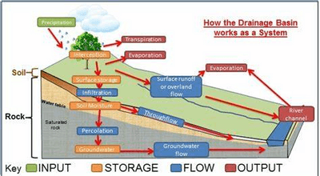

* **Catchment area** - the area within the drainage basin.
* **Watershed** - the edge of a highland surrounding a drainage basin. It marks the boundary between two drainage basins.
* **Source** - The beginning or start of a river.
* **Confluence** - the point at which two rivers or streams join.
* **Tributary** - a stream or smaller river joins a larger stream or river.
* **The mouth** is where the river ends, usually when entering the sea.

**Drainage basins act as a system with:**

* Inputs: precipitation
* Transfers: infiltration, percolation, surface runoff, throughflow & groundwater flow
* Stores: interception, surface storage, soil moisture storage & groundwater storage

Outputs: evaporation & transpiration or evapotranspiration

### **Drainage Basin Features**

 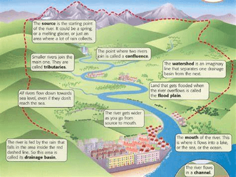

 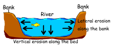

* **Bed:** The bottom of the river channel
* **Bank:** The sides of the river channel
  * A river has two banks
* **Width:** The distance between the two banks of a river
* **Depth:** The distance from the water surface to the bed of a river
* **Speed of flow:** how fast the water in a river is moving;
  different speeds arise at different parts of the river
* **Wetted perimeter:** length of the bed and banks in contact with the river
* **Channel:** The route course (between bed and banks) that a river
  flows. The flow of the river is often described as channel flow.
* **Thalweg:** The fastest part of the river, always near the middle of the river channel, where there is the least friction

### **River Processes**

1. Erosion
2. Transportation
3. Deposition

### **Erosion**

Erosion is the wearing away of surfaces.

 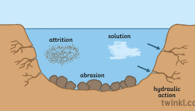

* **Attrition:** large particles such as boulders collide and break into smaller pieces.
* **Hydraulic action:** flowing water that hits against the riverbanks and beds.
* **Abrasion:** smaller particles rub against the riverbanks and bed like sandpaper.
* **Solution:** acid in rivers dissolves rocks; it occurs at any part of the river

### **Types of Erosion**

* **Vertical erosion**: dominant in the upper course of rivers. It increases the river's depth and valley as the river erodes downwards.
* **Lateral erosion**: dominant in the middle and lower course of rivers. It increases the width of the river and valley as it erodes sideways.

### **Transportation**

 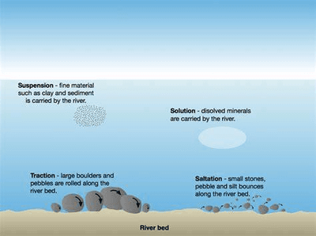

* **Traction:** rolling stones along the bed
* **Saltation:** small particles bounce along the bed in a leapfrog motion
* **Suspension:** silt and clay-sized are carried within the water
  flow
* **Solution:** minerals dissolve in the water

### **Deposition**

* When a river lacks the energy to carry its load, it deposits the heaviest particles.
* It happens when there is less water or where the current slows down
* Large boulders are deposited at the top, and very small particles are deposited at the end, resulting in sorting

### **River Profiles**

* **Long profile:**

 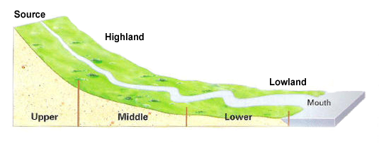

**Cross Profile**   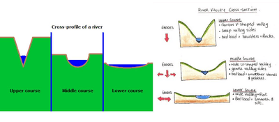

### **River Landforms and their Formation**

**Water Fall and Gorges:**

 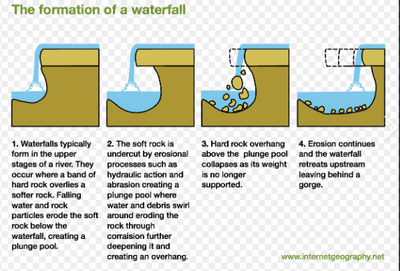 **V-shaped valley:**    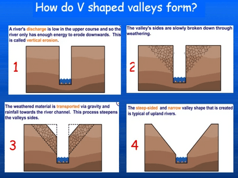

### **Interlocking Spurs**   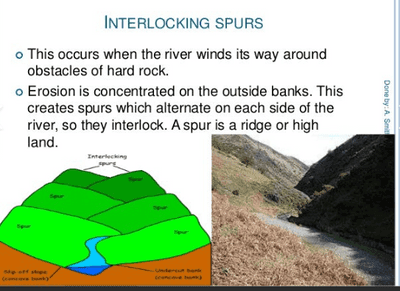

### **Meanders**

 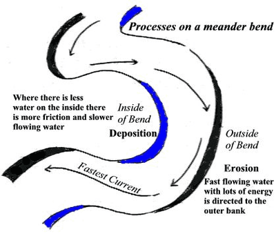

### **Oxbow Lake**

 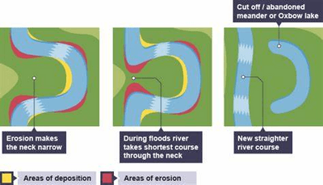

### **Floodplains and Levees**

 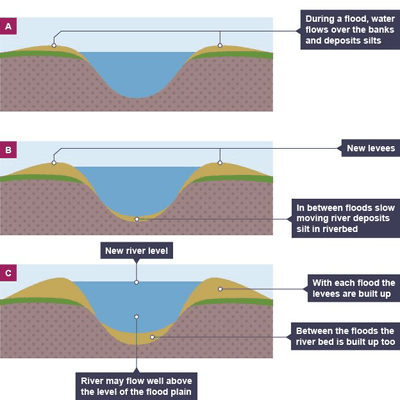

### **Floods**

* **Causes of flooding:**
  * No vegetation
  * Deforestation
  * Urbanization
  * Poor drainage
  * Steep slopes
  * Rock type (impermeable rocks do not absorb water)
  * Wet soil (over saturation)

| Impacts | Opportunities |
|----|----|
| People can be killed. | Water supply (drinking, washing) |
| Homes destroyed. | Fishing industry |
| Spread of waterborne diseases | Transportation for trading |
| Shortage of clean water and food | Tourism |
| Infrastructure damaged | Fertile soil |
| Businesses destroyed. | Powerplants (dams) |
|    | Sports/recreation |

### **Flood Management Techniques**

 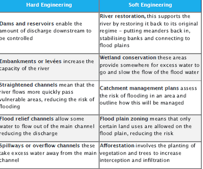