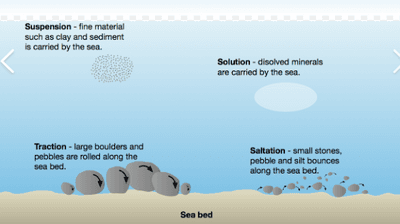
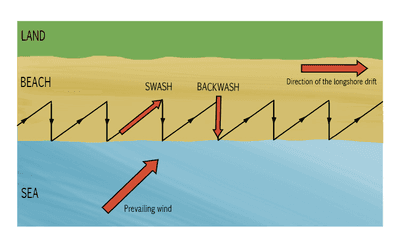
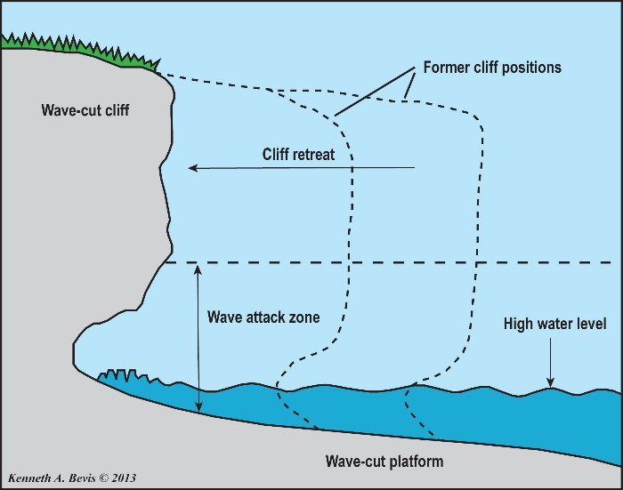
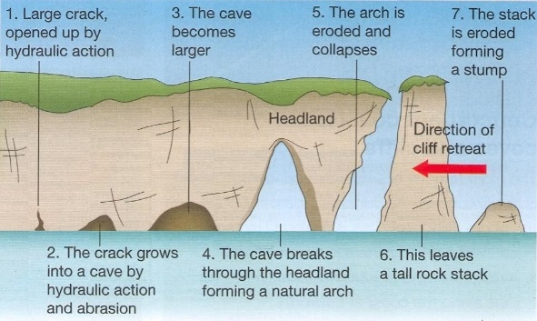
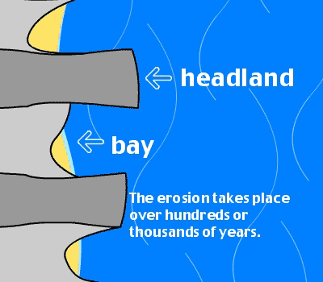
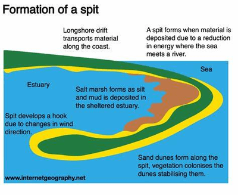
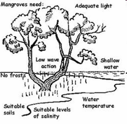
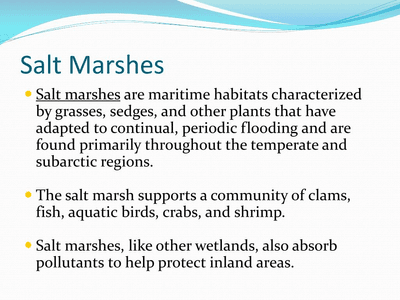

## Coasts

* The sea forms coasts and winds working together in 3 essential tasks: erosion, transportation and deposition
* **Components of a wave:**
  * **Swash:** when a wave breaks & washes up the beach
  * **Backwash:** when the water drains back into the sea

### **Types of Waves**

| Constructive | Destructive |
|----|----|
| Low wave height | High wave height |
| The beach gradient is gentle | The beach gradient is steep |
| Spill forward gently | Plunge forward |
| Creates a strong swash | Swash is weak |
| Water drains through beach material | Rotation of water causes a strong backwash |
| Backwash is weak | Erodes beaches |
| Deposits material |    |
| Builds up beaches |    |

**Erosion:**

* **Abrasion:** larger rocks and sediments like boulders grind against the riverbed
* **Corrosion:** salts and acids slowly dissolve a cliff
* **Attrition:** smaller sediments collide with each other while moving in the flow, making them rounder and smaller
* **Hydraulic action:** the force of waves compresses air in cliffs

**Transportation:**

 **Longshore Drift:**

* Waves approach the coast at an angle
* Swash moves up the beach at an angle
* Backwash drains straight back down the beach
* Gradually moving material along the beach in a zig-zag motion

   

| Coastal Opportunities | Coastal Threats |
|----|----|
| Sports/recreation | Hurricanes |
| Groundwater recharge | Coastal storms |
| Habitat for fish | Tsunamis |
| Transport (shipping goods) | Landslides |
| Tourism | Flooding |
| Job opportunities | Coastal erosion |

### **Coastal Management**

**Hard Engineering:**

| Name | Located at | Advantages | Disadvantages |
|----|----|----|----|
| Sea wall | Coastlines/foot of cliffs | Reduce erosion and prevent flooding; Curved structure breaks waves | Very expensive and big, requires constant maintenance |
| Groynes | In front of the area facing coastal erosion | Increases distance between waves and coasts → Waves lose energy → Reduces impacts of waves. | Certain sections of the coast may be more exposed to erosion |
| Gabions | Base of cliff | Reduces the impact of waves on a cliff, prevents cliff from being undercut, and cheap | Not as effective as other coastal defences |
| Revetments | Slanted barrier against waves at the base of the cliff | Absorbs energy of waves, prevents cliffs from being eroded; Rippled surfaces help dissipate wave energy; No need for much maintenance | Expensive |
| Rip-raps | Rocks and stones put against the base of the cliff | Absorbs wave energy, protects cliffs behind | Visual pollution, susceptible to being moved by the sea |
| Breakwaters | Near coasts | Effective, breaks incoming water | Visual pollution easily destroyed |
| Tidal barriers | Side of coasts | Prevents storm surges, very effective | Expensive |

**Soft Engineering:**

| Name | Description | Advantages | Disadvantages |
|----|----|----|----|
| Beach nourishment | Sand/shingle added to the beach | Increases distance between waves and cliffs → Waves lose energy → Less erosive power. | Effectiveness is uncertain |
| Land management | Protect and rebuild dunes | Good barrier against coastal flooding and erosion | Tourism is affected as dunes are marked out of bounds to the general public |
| Marshland |    | Break up waves and reduce speed and power of waves → Limits area which waves can reach → Prevents flooding | Effectiveness is uncertain |
| Beach stabilization | Planting dead trees in sand to stabilize | Widen beach and reduces wave energy, lowers the profile of the beach | Effectiveness is uncertain |

### **Landforms**

**Cliffs and wave-cut platforms:**

* Wave erosion is concentrated at the foot of the cliff
* A wave-cut notch is formed
* The cliff is undercut & collapses
* Repeated collapse causes retreat of the cliff

 

**Caves, Arches, and Stack:**

* A band of weaker rock extends through a headland.
* Erosion produces caves on both sides of the headland.
* More erosion produces an arch through the headland.
* Eventually, the roof is weak & collapses, forming a stack.

 **Beaches:**

* In bays, the waves diverge outwards.
* The wave energy is dissipated, creating a low-energy environment. Hence, deposition to form beaches.

**Bays and Headland:**

 

* Bays are formed due to softer rock getting eroded easily
* Headlands are usually formed since they are made of resistant rock and are eroded more difficultly.

**Spits:**

 

* Spits form when the coastline changes direction
* Longshore drift carries material in the same direction
* Sand & shingle is built up to form a spit
* End of spit curves due to wave refraction or wind.

**Sand Dunes:**

* Dunes form behind wide sandy beaches
* Onshore winds pick up the dry sand from above the high-water mark &
  carry it landward by saltation
* If they encounter an obstacle, the wind loses energy & deposits sand in the lee of the obstacle
* Eventually, a dune is formed
* Plants grow on it, which stabilizes it & traps more sand

**Mangrove Swamps:**

* Mangrove swamps are trees and shrubs that grow in saline coastal
  habitats in the tropics and subtropics
* Provide habitat and protection for many fish & other sea animals, especially when young
* They slow water flow, encouraging any sediment to be deposited, keeping sea water clear
* Protect the coast from erosion, storm surges, hurricanes, and
  tsunamis
* They are a source of food and material
* Conditions required for the formation of mangrove swamps:

 

**Coral Reefs:**

* Coral reefs support a great diversity of life
* Built from the limestone remains of coral skeletons & coralline
  algae
* **Conditions required for the growth of coral reef:**
  * Warm water/seas; temperatures 20 - 30C
  * Shallow water; not more than 60 meters deep
  * Water free from sediment/clear/availability of light
  * A plentiful supply of oxygen in water/unpolluted
  * A plentiful supply of plankton
  * Lack of strong current

**Salt Marshes:**

 