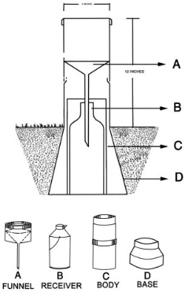
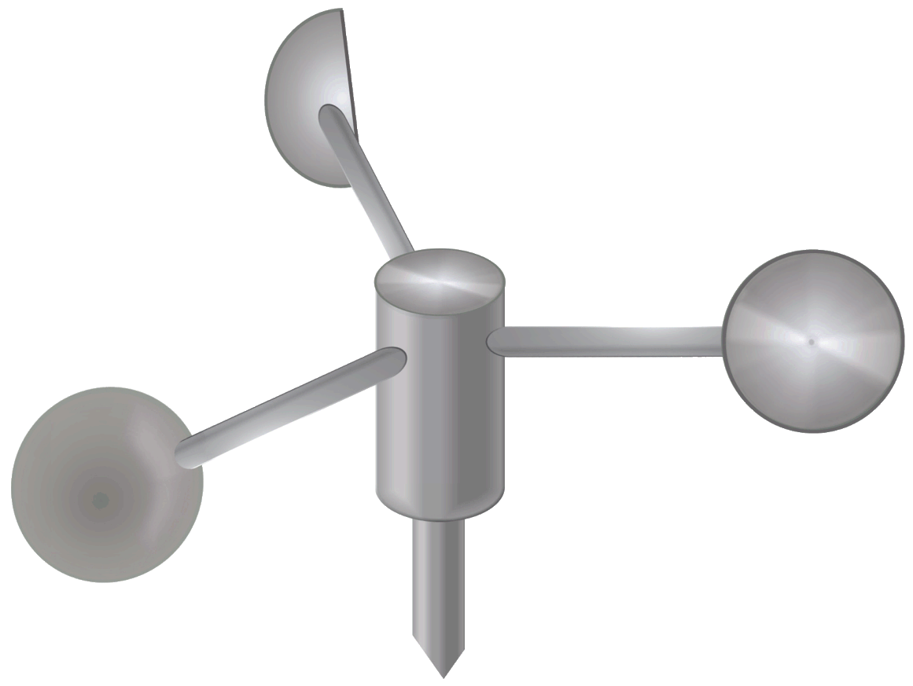
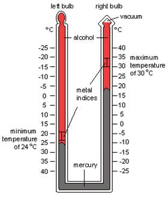
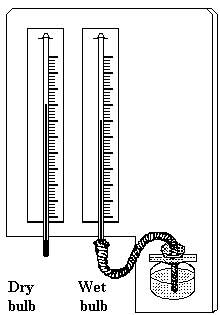
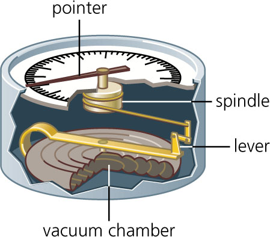
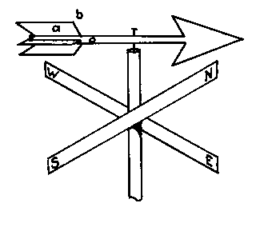

## Weather

* **Weather:**
  * The mix of events that occur in our atmosphere, including
    changes in temp., rainfall and humidity
  * It can vary from day to day and from place to place

Weather data is collected by; 

### **Stevenson’s Screen:**

*  contains the thermometers

* Painted white to reflect the sun with a double lid for insulation

* Slatted sides to let the air circulate, but slanted downwards to prevent light from getting in

* Legs 1m long to prevent heating from the ground

* On short grass for the same amount of reflection

**Protip:** essential to know the features of Stevenson’s screen

**Protip:** important to know what weather instruments look like and have brief knowledge of how to use

---

### **Rain Gauge:** 

* has a fixed diameter so that they collect the same
  amount of water & so comparisons can be made

* Made of a hollow cylinder (C) containing:
  * Funnel (A) to collect the water.
  * Container to collect water, which may be graduated
  * Emptied once every 24hrs
  * Rain is measured in millimetres.
  * Sunk into the ground, but not level, so splashes or surface water can’t get in.

---

### **Anemometer:** 

* Measures wind speed

* Three light rotating cups (mounted on a high pole) are blown around
  by the wind the revolutions are counted & converted into m/s, km/h
  or knots

---

### **Sunshine Recorder (Heliograph):** 

* records the amount of sunshine at a
  given location

* Burns a timeline
* Trace sunshine not the hours of daylight
* The glass ball focuses the light
* This burns a line onto the card

---

### **Max-min thermometer:**

*  Records max. & min. Temp. over 24hr period

* Max thermometer contains mercury & min contains alcohol
* As temp. rises, mercury expands & pushes up a metal index, and when it cools, mercury contracts, and the index is left in place at highest temp
* As temp. falls, alcohol contracts & pulls metal index with it; but as alcohol expands, it flows past index, leaving it at its lowest temp
* Both indexes read from the bottom once every 24hrs

---

### **Wet & dry bulb thermometer (hygrometer):** 

* Used to calculate the humidity of the air

* A dry bulb is a normal mercury thermometer, and it measures actual air temperature
* The wet bulb is the same but is covered with a fine cloth connected to a water reservoir.
* Water evaporates from the cloth & cools temperature so it reads a
  few degrees lower than air temp.
* Both wet & dry bulb temperatures read.

---

### **Barometer:** 

* Measures air pressure

* An aneroid barometer has a vacuum chamber
* As air pressure rises & falls, the chamber contracts & expands
* Levers conduct this movement to a spindle, which moves the pointer on the dial, which records the air pressure in mmHg

**Protip** - Unit used: mb/millibars (was asked in 2021 Geography paper 4)

---

### **Wind Vane:** 

* Records wind direction

* The wind blows the fletching so that the arrowhead points into the wind.
* Mounted on high places (rooftops)
* Make sure no trees are blocking