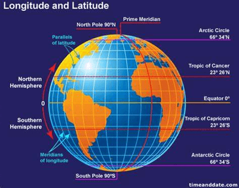
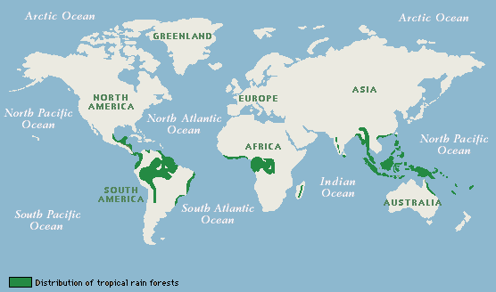
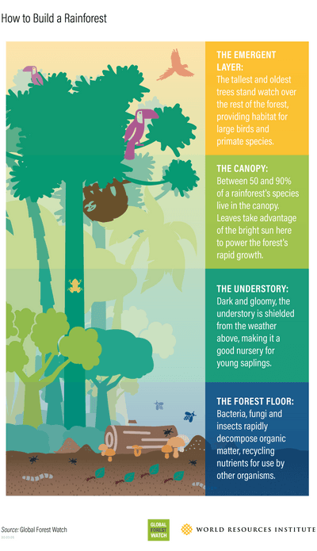
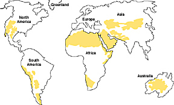

## Climate & Natural Vegetation

* **Weather**
  * Describes the condition of the atmosphere, e.g. sunny, hot, windy
* **Climate**
  * This is the average condition over a longer period, usually a few years.

**Factors Influencing Climate Characteristics:**

* **Latitude:** closer to the equator = higher temperature
* **Distance from the sea:** coastal area = warmer winters and cooler
  summers
* **Prevailing winds:** The seasonal difference in heating between land and the sea affects the temperature of the prevailing wind. Warm prevailing wind = rise in temperature
* **Ocean currents:** warm currents raise winter temperatures in
  coastal areas; cold currents cool them down in summer
* **Altitude:** higher altitude = lower temperature (1° per 100m)

### **Tropical Rainforest**

**Distribution:**

**Structure:**

**Climate:**

* They are close to the equator, so they have very similar climates all year around
* Temp. is constant between 25-30°C
* Rainfall all year around, monthly amounts vary slightly
* Days start warm & then temp. and humidity build-up
* Hot air rises, causing low pressure.

**Adaptations:**

|Plants|Animals|
|:---|:---|
|**Drip tips** - plants have leaves with pointy tips. This allows water to run off the leaves quickly without damaging or breaking them.|The **sloth** uses camouflage and moves very slowly, making it difficult for predators to spot.|
||The **spider monkey** has long, strong limbs to help it to climb through the rainforest trees.|
|**Epiphytes** are plants that live on the branches of trees high up in the **canopy**. They get their nutrients from the air and water, not the soil.|The **flying frog** has fully webbed hands and feet and a flap of loose skin that stretches between its limbs, which allows it to glide from plant to plant.|
|**Lianas** - vines which use the tall||
|trees as support to reach the||
|sunlight|The **toucan** has a long, large bill to allow it to reach and cut fruit from branches too weak to support its weight.|

**Deforestation of tropical rainforests**

* **Causes:**
  * Population growth
  * Economic growth
  * Mining
  * Road building
  * Agriculture
  * Urbanisation
  * Exploitation of land by TNCs
* **Effects:**

|Local environment|Global environment|People|
|:---|:---|:---|
|Loss of vegetation|Melting ice|Death of local tribes people|
|Causes floods|Global warming/increase temperatures|More carbon dioxide|
|Threatens species with extinction|Rising sea levels|Less oxygen|
|Loss of habitat|Changes in climate patterns e.g. drought|Reduction of materials available to build buildings|
|Reduction of food supply|Loss of species such as polar bears||
|Soil erosion|||
|Food chain disrupted|||

### **Hot Deserts**

**Distribution:**

**Vegetation & Animal Adaptations:**

|Vegetation|Animal|
|:---|:---|
|Seeds remain dormant|Camel have humps to store water|
|Waxy leaves to reduce transpiration|Foxes have big ears to reduce heat|
|Thorns to protect from predators|Shelter in underground to avoid heat|
|Long roots to search for water|Only comes out at night to hunt|
|Thick stem to store water||
|Light colours to reflect sunlight||

**Climate:**

* Deserts are extremely dry (arid) places
* Have less than 250mm of rainfall per year
* Air is dry because:
  * Most of the moisture has precipitated over the equator
  * Air travelling to the desert travels over land, not the sea
* No moisture leads to very few clouds, exposing them to high levels
  of incoming radiation from the sun
* Causes day-time temps. to be very high
* The lack of cloud cover allows outgoing radiation to escape
* Causes night-time temps to be low
* **The annual temperature** range is very low
* **Daily temperature** range is very high