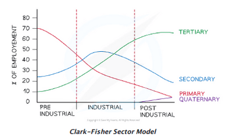
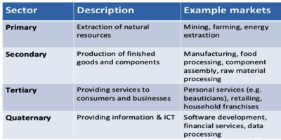
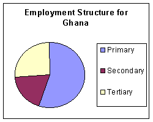
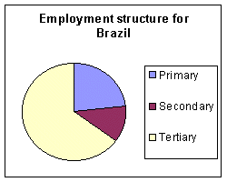
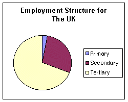

# Theme 3: Economic Development

## Development

* **Development** is the process of a country where it improves its quality of life for its people, making its place more independent.
* **Stages of development:**
  * Least developed countries → developing countries → newly developed countries → Developed countries.
* **Quality of life** is the person’s well-being in terms of environment, security, health and happiness.

### **Indicators of Development**

* **Gross National Product (GNP) per capita**: wealth of a country averaged per person.
* **Gross Domestic Product (GDP) per capita**: the total value of goods and services produced within a country in a year divided by the country's population.
* **Birth Rate:** number of births in a year per 1000 of the total population
* **Death Rate:** number of deaths in a year per 1000 of the total population
* **Literacy** **rate**: the percentage of people who can read and write.
* **Life expectancy**: the amount of time one is expected to live
* **Infant Mortality:** average number of deaths of infants under 1 per 1000 live births per year.
* **Composite indices like the Human Development Index (HDI):** measure the disparities between countries.

### **Economic Sectors**

* **Economic activity** involves making, providing, purchasing, or selling goods or services.
* Economic activity can be divided into 4 categories:
  * Primary.

  * Secondary.

  * Tertiary.

  * Quaternary.

    

**Sectors of the Industry:**

---

* **Comparing Nations:**

  \
  **An LEDC, e.g. Ghana**

  * The majority are in the primary sector.
  * Few in the secondary sector.
  * Tertiary may be larger than secondary.

**A NIC, e.g. Brazil**

* Majority tertiary.
* Few in the secondary sector primary.
* Primary is larger than secondary.

**An MEDC, e.g. UK**

* Low proportion in the primary sector.
* Numbers are falling in the secondary sector.
* The tertiary sector is the primary growth area.

---

### **Globalisation**

* Process in which the world is becoming increasingly interconnected through economic, cultural, political and tourism processes.
* **Causes of globalisation:**
  * Improvements in transportation
  * Freedom of trade
  * Improvements of communications
  * Labour availability and skills
* **Impacts of globalisation:**

|Positive|Negative|
|:---|:---|
|Economic growth|Economic Inequality|
|Job Creation and Employment|Job Displacement and Labor Exploitation|
|Access to Goods and Services|Environmental Degradation|
|Cultural Exchange and Diversity|Cultural Homogenization|
|Technological Advancements|Exploitation of Developing Countries|
|Access to Information and Communication|Social Disruption and Inequality|
|Environmental Awareness and Sustainability|Public Health Risks|

### **TNCs (Transnational Corporations)**

* Companies that operate in more than 1 country, usually in foreign countries or overseas.

|Advantages|Disadvantages|
|:---|:---|
|Job opportunities|Labour drain.|
|Improvement in skills and communication.|Damage to the environment - factories create air pollution.|
|Good education, healthcare and good quality of life.|Cultural dilution or loss of cultural identity.|
|Invest in infrastructure.|Social mobility is limited to urban areas.|
|Cheaper products|Profits going overseas.|
|Greater choice of goods|Natural resources are being over-exploited.|
|High level of income from tourism, exports, imports|Movement of people, transport ownership and loss of biodiversity increases globally.|
|Access to vast levels of skills and resources.|Daily living costs increased.|
