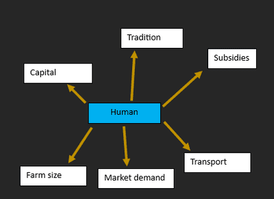
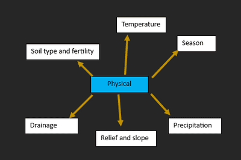
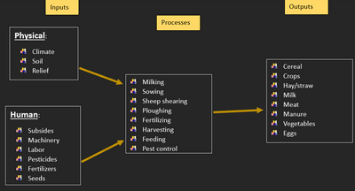

## Food Production

### **Agriculture**

**Farming types**:

* Commercial and subsistence
* Arable, Pastoral and mixed
* Intensive and extensive

**Factors influencing the type of agriculture:**

      

---

### Food Shortages & Famine

* When demand for food exceeds the supply of food, leading to undernourishment
* Prolonged undernourishment can damage people's health and eventually
  lead to starvation

|Human Causes|Physical Causes|
|:---|:---|
|Increasing population- supply cannot keep up with demand.|Too hot or cool temperatures can kill crops and animals.|
|Overgrazing reduces the integrity of the soil and can cause topsoil erosion and soil degradation.|Shortage of rainfall kills most crops or requires irrigation.|
|Over cultivating causes soil degradation, using up and not giving nutrients recovery time.|Too much rain can flood & kill crops or wash away topsoil, reducing soil fertility and leading to low yield.|
|Deforestation of woodland damages the integrity of the soil and its source of nutrients.|Natural disasters can destroy large areas of agricultural land and kill or injure farmers.|
|Farming and industrial pollution can both degrade land and reduce crop yields.|If soil is infertile because the bedrock contains few minerals, cultivating land can be hard, leading to low yields.|
|Corruption of government, war and conflict.|Diseases: these reduce yields and can result in livestock deaths/|

* **Effects:**

  * Hunger and rising food prices.
  * Susceptible to infectious diseases.
  * Impair physical and mental development.
  * Reduce labour productivity,
  * Undernutrition and malnutrition.
  * Wasting.
  * Soil erosion and desertification.
  * Migration.

* **Solutions:**

|Possible solution|How it works|Advantages|Disadvantages|
|:---|:---|:---|:---|
|Food aid|This can be short (after a disaster or in a crisis) or long term (often given to the LEDC government to distribute). The aid is given by MEDCs often through organisations such as the World Food Programme (WFP) as well as by Non-Governmental Organisations (NGOs) such as Oxfam and Save The Children|Saves lives during a crisis|Can increase dependence of LEDCs on food aid; Reduces the sales of crops grown by local farmers; Expensive to transport|
|Irrigation|The artificial watering of crops - the success of this is dependent on the type of irrigation; Surface irrigation or drip irrigation|Increases crop production/yields in areas with low rainfall|Loss of water through evaporation; Increases salinity of the soil affects crop growth|
|Genetically Modified (GM) crops|When the genetic material of a crop is altered to make them disease/pest resistant, have a higher yield or be drought resistant|Increases the yield of crops as they are not as susceptible to pests/disease|Concerns about the impacts on the environment|
|Green Revolution and High Yield Varieties|Involved in the development of high yield varieties of main food crops including wheat, maize and rice|Increased yields; Larger farm incomes increased|Needed high inputs of fertilisers/pesticides; Increased mechanisation leads to fewer jobs|
|Education of farmers|Education for farmers about sustainable farming methods|Low cost; Increases farming knowledge; Increases yields||
|Mechanisation|Use of tractors and other machines to complete farming tasks|Incrases yields as more land can be cultivated; More time efficient; Less labour needed|Reduces jobs in agriculture; Machines can be expensive to buy and maintain|
|Fertilisers/ Pesticides|Fertilisers are added to increase yields through adding nitrogen; Pesticides are used to kill or deter pests from eating crops|Increases the yield; Reduces losses from pests|Damage to the environment e.g. eutrophication; Concerns about the impact on human health|
|Appropriate technology|Includes methods such as Contour ploughing or intercropping|Increases yield as water infiltration improves and soil erosion decreases||
