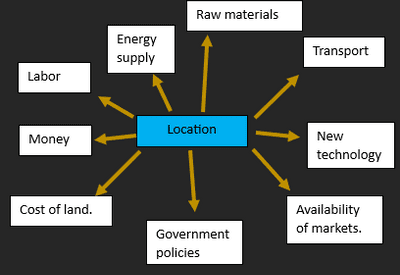

## Industry

Industrial systems have inputs, processes and outputs.

* **Input:** resources that need to start the process can be physical.
* **Processes:** turning raw materials into usable things.
* **Outputs:** product + profit or loss + waste materials
* **Types of Industry:**
  * **Manufacturing:** produces goods that are physically used by consumers, e.g. toys
  * **Processing:** turns raw materials into other materials used in manufacturing, e.g. metal production
  * **Assembly:** using materials and a design scheme to put together a finished product, e.g. electronics
  * **Hi-Tech:** specialized industries that mostly do research but often have small sections dedicated to each of the 3 standard types of industry

|Industry|Input|Processes|Output|Impact|
|:---|:---|:---|:---|:---|
|Steel production|Alloy: chromium and cobalt|Electric furnace, oxygen, rolling, cutting.|Steel, sheets, waste, slag, gases.|Noise, dust, smell and water pollution.|
|Iron production|Iron ore, coke, limestone, water, iron.|Blast furnace|Iron, slag, gases, heat and water.|Noise, air, smell, water and waste.|

**Factors influencing location of an
Industry**

