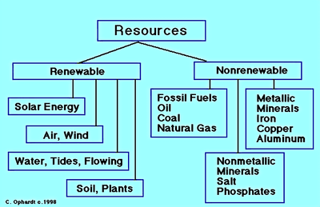

## Energy

* The demand for energy across the globe is rising.
* Population growth and development are the two leading causes of the increase in energy demand.

### **Renewable** **Energy**

Renewable Energy; is energy which comes from natural resources:

* **Solar energy**: energy derived from the sun through solar radiation.

|Advantages|Disadvantages|
|:---|:---|
|No greenhouse gas emissions|Expensive to install|
|No air pollution|Not reliable; only works when it is sunny-|
|Can be small or large-scale|Large numbers needed to produce energy|
|Can be used in most locations|Uses large areas of land|
|Can be incorporated into building design||
|Technology is improving and reducing cost||

* **Wind energy**: conversion of wind energy into a useful form of energy.

|Advantages|Disadvantages|
|:---|:---|
|No greenhouse gas emissions|Not reliable only works when the wind is strong enough but not too strong.|
|No air pollution|Visual pollution.|
|Can be small or large-scale|Noise pollution|
|Cheap to run.|Many turbines are needed to produce the same energy as an average coal-fired power station.|
|Can be on land or offshore.|May affect bird migration patterns or kill birds who fly into the moving blades.|

* **Hydro energy**: the power derived from the force or energy of moving water.

|Advantages|Disadvantages|
|:---|:---|
|No greenhouse gas emissions|Large areas of land are flooded behind the dam.|
|Control flooding downstream.|Dam traps sediment, which can affect ecosystems downstream.|
|Provide water storage for irrigation and domestic use|Visual pollution|
||Can prevent fish movement upstream.|
||People and settlements may have to be relocated.|
||Expensive to build and maintain.|

* **Geothermal energy:** energy obtained by tapping the heat of the earth itself.

|Advantages|Disadvantages|
|:---|:---|
|No CO gases|Expensive|
|Lots of potential sites.|Emits sulfuric gases|
|Reliable.|High temperatures cause maintenance issues.|
|Can produce large amounts of energy.||

* **Biomass:** is a renewable energy source, biological material from living.

|Advantages|Disadvantages|
|:---|:---|
|Uses waste or biomass which can be regrown.|Air pollution.|
|Available in most locations.|Produces greenhouse gases.|
||Expensive|

* **Wave/Tidal**: is a renewable energy source, using the gravitational forces of the moon

|Advantages|Disadvantages|
|:---|:---|
|No greenhouse gas emissions.|Expensive to build and maintain.|
|Reliable.|Can affect marine ecosystems|
|Has the potential to produce large amounts of energy.|Few suitable sites.|
|No air pollution.||

### **Non-Renewable energy**:

* Fossil fuels are formed from living organisms' remains (plants/animals). These are non-renewable as they cannot be replaced at a speed which keeps up with consumption.
  * Coal
  * Oil
  * Gas

---

||Advantages|Disadvantages|
|:---|:---|:---|
|Coal|It lasts 300yrs, now become more efficient, needed to make coke|The cost of production is high, produces a lot of GH gases, is dangerous, open cast = visual pollution, costly to transport, acid rain|
|Oil|More efficient than coal, more accessible to transport, diversity of uses, petro-chemicals|It lasts only 50-70yrs; oil spills release greenhouse gases, prices fluctuate, refineries use a lot of space, acid rain|
|Gas|Cleanest of fossil fuels, cheaper than oil, easy to distribute|It releases methane, explosives, prices fluctuate, acid rain, and greenhouse gases.|
|Nuclear power|-Plenty of radioactive supply as fuel. -Very low amounts of greenhouse gases made. -Reduces dependency on fossil fuel countries. -Nuclear waste stored safely underground. -Electric supply altered quickly based on demand.|- Risk of nuclear accidents. - Risk of nuclear plants as terrorist targets. - Nuclear technology can be used to make WMDs. - Remains radioactive for a long time & expensive. - Uranium mining is dangerous and polluting.|
